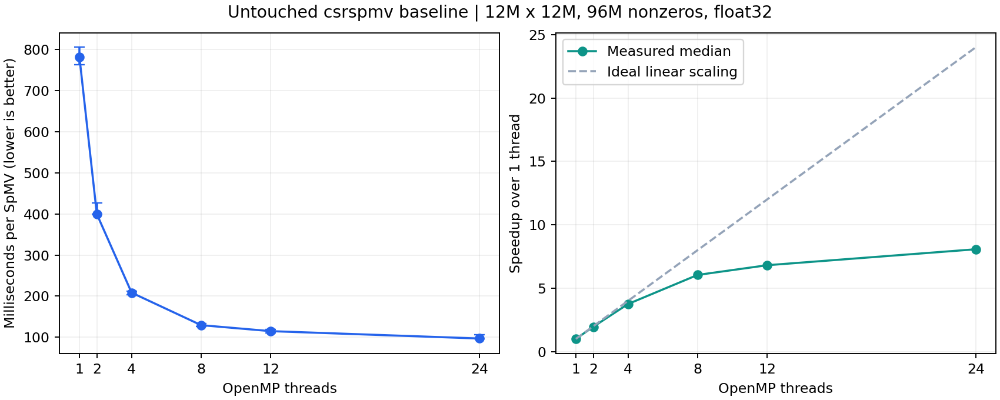

# 原始 csrspmv 基线实测结果

实验日期：2026-10-25。汇总生成时间：2026-10-25T14:53:49.987772+08:00。

## 正式基线

原始版本 `9352c865044f4c8b344d6fe5a277200a89f7a08b`，GCC 11.4.0，`-O3 -march=native -fopenmp`，未启用 fast-math。矩阵为 1200 万 × 1200 万、9600 万个非零元，f32。每个进程重复 9 次，每组 3 个独立进程；以下为每次 SpMV 的统计。

| 线程数 | 中位耗时 / ms | 最小–最大 / ms | GFLOP/s | 相对 1 线程加速比 | 并行效率 |
| --- | --- | --- | --- | --- | --- |
| 1 | 782.045 | 762.844–805.801 | 0.2455 | 1.00× | 100.0% |
| 2 | 399.667 | 399.242–426.834 | 0.4804 | 1.96× | 97.8% |
| 4 | 208.425 | 203.189–211.526 | 0.9212 | 3.75× | 93.8% |
| 8 | 129.364 | 126.528–133.672 | 1.4842 | 6.05× | 75.6% |
| 12 | 114.824 | 110.082–119.443 | 1.6721 | 6.81× | 56.8% |
| 24 | 96.908 | 95.910–105.928 | 1.9813 | 8.07× | 33.6% |

本次原始代码各线程配置中，中位耗时最低的是 **24 线程，96.908 ms/次，1.9813 GFLOP/s**，相对原始代码单线程为 8.07 倍。这个加速比反映已有 OpenMP 随线程数的扩展，不能作为本人新增优化效果。

## 关闭自动向量化的对照

同一源码、矩阵、重复次数、线程绑定和测试轮次，仅增加 `-fno-tree-loop-vectorize -fno-tree-slp-vectorize`。

| 线程数 | 默认基线中位耗时 / ms | 关闭自动向量化 / ms | 关闭后 / 默认耗时 |
| --- | --- | --- | --- |
| 1 | 782.045 | 660.666 | 84.5% |
| 12 | 114.824 | 103.870 | 90.5% |

GCC 的 f32 内层循环诊断和对应汇编均确认默认基线已包含向量化。每行 8 项进入 256 位 gather/乘法路径，求和仍为标量加法链。因此，应区分“生成了 SIMD 指令”与“对该负载一定有收益”；性能以表中数据为准。fast-math 只做编译诊断，没有作为正式优化参与此表。

## 正确性、资源与瓶颈判断

- 三个构建的 12 组小矩阵用例，以及 1 组生成器独立校验通过；包括非均匀 x、矩形矩阵、重复坐标、空行、负数和重复累加。
- 大矩阵在 1 线程重复 1 次、12 线程重复 3 次时，全量核对各 1200 万个输出元素，最大绝对误差为 0。参考语义是 `y = repeat × Ax`。
- 正式样本最大进程 RSS 为 1.879 GiB。该数值包含读入的坐标数据与 CSR 转换时的峰值，不是只有内核工作集。
- 各行均有 8 个非零元；原程序的 `--count-nonzeros` 分配结果见 `raw/balance-t12.txt`、`raw/balance-t24.txt`。这是行长均匀的负载，不能由本实验评估不均匀行长的调度优化。
- CSR 约 864 MB，x、y 各 48 MB，远超 WSL 报告的缓存规模；x 的列访问在全局分散。结果适合继续研究间接访存、缓存复用、gather 成本和线程扩展，而非用 tiny test 的耗时推断大矩阵表现。
- 线程扩展、向量化对照属于现象证据，不能单凭加速曲线就宣布“DRAM 带宽已饱和”。本次没有独立测得持续内存带宽上限，也没有生成正式 Roofline 图。
- `logical_access_model_GBps` 是 README 中定义的逻辑访问模型，不是硬件实测 DRAM 带宽；GFLOP/s 按每个非零元乘、加各一次计数。
- 运行于 WSL 和笔记本宿主机；未锁定宿主机频率，也未独占系统。三个样本的极差仅用于显示本次波动。结论限于本机、当前编译器、f32 和这一种矩阵分布。

## 文件索引

复现实验步骤和解释见 [README.md](README.md)。逐次数据见 [measurements.csv](measurements.csv)，汇总见 [summary.csv](summary.csv)，配置见 [protocol.json](protocol.json)，输入来源及校验和见 [matrix.json](matrix.json)。原始 stdout/stderr、命令与资源记录在 `raw/`。

可选 perf 采样与上述正式计时分开保存；若执行，采样解释另见 [采样分析.md](采样分析.md)，它不改变本表结果。
