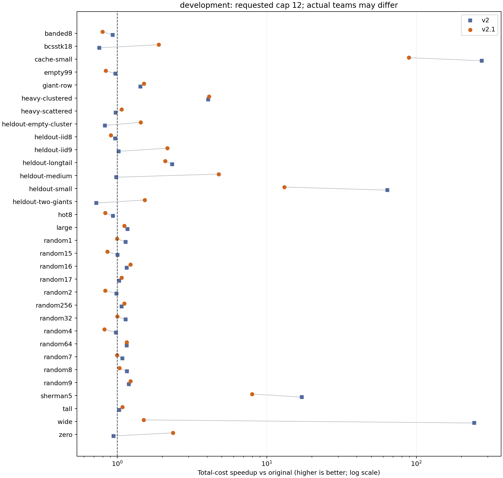
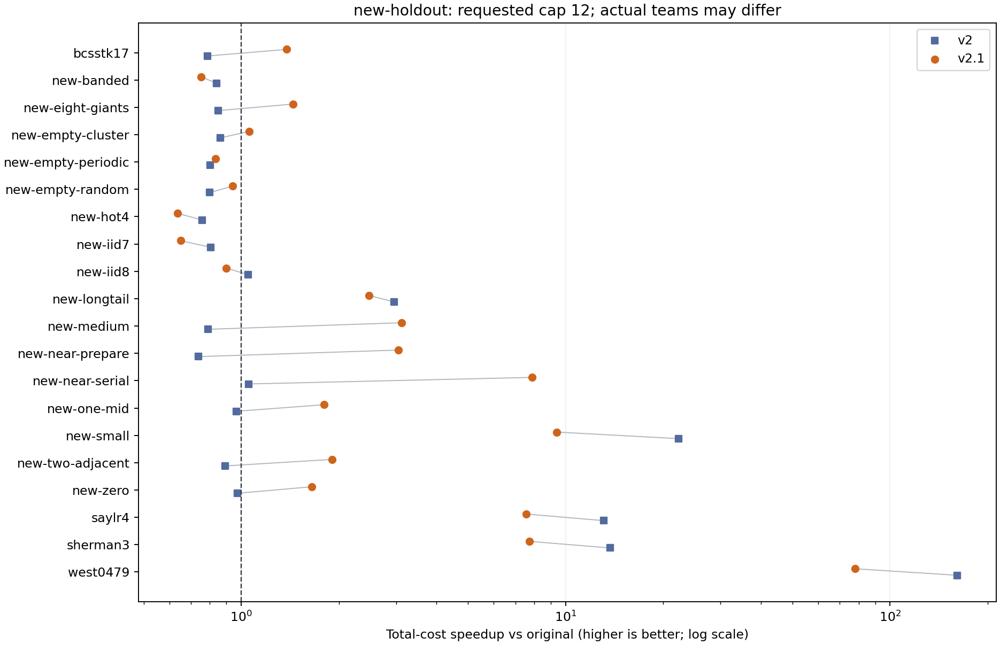

# v2.1 实验结果与适用范围

源码先提交并推送，随后使用固定提交构建，正式计时期间没有修改代码/profile。v2.1为v2的直接子分支；master与v2均保留。

正式性能进程共 **1835** 个；52个输入。结果指标为逐进程准备+执行+清理后取中位数；全程wall另列。

## 1. 主大矩阵与分支判定

原始R9最佳已测团队为24，total=0.771296s；v2.1请求上限24时total=0.798083s，对该原始配置时间变化+3.47%；同批v2为0.679335s，v2.1相对它变化+17.48%。

请求上限24时，相邻配对的原始/v2.1加速比区间为[0.946,1.005]。若原始最佳已测团队不是24，这个区间不能外推为对最佳团队的区间。

本条件v2.1实际选择original，实际线程24；v2实际选择short8。应先将差异理解为策略选择结果，不能仅凭进程中位数归因于某个内核指令。

**判定：未通过本轮稳健升级门槛，工作区切回v2；v2.1代码和远端分支保留，不合并。**

采用预先约定的主目标、对v2不超过3%退化、旧输入退化数减少和关键组不超过5%退化等共同门槛。门槛是工程选择，不是普遍定理。

| 请求上限 | R | 原始total/ms | v2 total/ms | v2.1 total/ms | v2.1 P/ms | v2.1实际策略/线程 |
| --- | --- | ---: | ---: | ---: | ---: | --- |
| 1 | 9 | 6609.731 | 5119.669 | 5352.043 | 44.965 | csr; T=1 |
| 12 | 9 | 957.392 | 815.965 | 858.211 | 12.510 | csr; T=12 |
| 24 | 1 | 88.255 | 90.206 | 101.099 | 12.560 | original; T=24 |
| 24 | 9 | 771.296 | 679.335 | 798.083 | 12.527 | original; T=24 |
| 24 | 100 | 9034.689 | 7905.063 | 9223.105 | 13.097 | original; T=24 |

主大矩阵R9、上限24的全进程wall中位数：原始10.51s，v2 10.61s，v2.1 10.73s。它包含MTX读取和转换，不能把SpMV阶段变化率当作全程序变化率。

主条件中每个控制10个进程，v2.1来自两组配对共20个；表中使用该条件全部样本中位数。区间分别只用对应控制的10个相邻进程对，配对点值另见paired-analysis.json。R敏感性及T1补充每方5个进程，不混为同一配对设计。

## 2. 关键退化组：不删负结果

| 输入 | 上限T | 原始/ms | v2/ms | v2.1/ms | v2.1相对原始时间 | v2.1策略/实际T |
| --- | --- | ---: | ---: | ---: | ---: | --- |
| bcsstk18 | 12 | 2.169 | 2.859 | 1.144 | -47.22% | csr/2 |
| bcsstk18 | 24 | 3.726 | 4.986 | 1.288 | -65.43% | csr/2 |
| empty99 | 12 | 4.863 | 4.990 | 5.800 | +19.26% | original/8 |
| empty99 | 24 | 5.508 | 6.842 | 5.697 | +3.42% | original/8 |
| giant-row | 12 | 10.116 | 7.079 | 6.702 | -33.75% | merge/8 |
| giant-row | 24 | 12.637 | 11.006 | 6.802 | -46.18% | merge/8 |
| heavy-clustered | 12 | 69.740 | 17.160 | 16.954 | -75.69% | csr/12 |
| heavy-clustered | 24 | 68.641 | 15.723 | 17.652 | -74.28% | csr/12 |
| heldout-empty-cluster | 12 | 2.450 | 2.956 | 1.707 | -30.31% | original/1 |
| heldout-empty-cluster | 24 | 4.852 | 5.524 | 1.755 | -63.84% | original/1 |
| heldout-two-giants | 12 | 3.282 | 4.532 | 2.144 | -34.66% | merge/2 |
| heldout-two-giants | 24 | 5.090 | 8.415 | 2.246 | -55.86% | merge/2 |

## 3. 逐例回归与新保留集

旧输入T12共32例，以原始项目为控制：v2（快超过5%：16例，±5%内：10例，慢超过5%：6例）；v2.1（快超过5%：21例，±5%内：4例，慢超过5%：7例）。新输入T12共20例：v2（快超过5%：6例，±5%内：3例，慢超过5%：11例）；v2.1（快超过5%：14例，±5%内：0例，慢超过5%：6例）。这些计数不是逐例显著性结论，也不是实际工作负载权重。

直接以v2为控制，旧输入T12的v2.1为（快超过5%：9例，±5%内：6例，慢超过5%：17例），新输入T12为（快超过5%：10例，±5%内：1例，慢超过5%：9例）。小输入在原始多线程前取得大加速，也可能仍明显弱于v2已有串行策略，两种对照必须同时看。

本轮旧输入的zero/cache-small/wide使用R100，其余使用R9；旧heldout-small本轮使用R9，上一轮为R100。因此这里的胜负计数只用于本轮三方同批对照，不与上一轮计数作严格配对。新保留输入按存储项数小于20000时R100、其余R9。

| 组别 | 输入 | 上限T | R | 原始/ms | v2/ms | v2.1/ms | 相对原始时间 | 策略/实际T |
| --- | --- | --- | --- | ---: | ---: | ---: | ---: | --- |
| heldout | bcsstk17 | 12 | 9 | 2.020 | 2.567 | 1.462 | -27.60% | csr/4 |
| heldout | bcsstk17 | 24 | 9 | 3.497 | 4.751 | 1.624 | -53.57% | csr/4 |
| heldout | new-banded | 12 | 9 | 2.880 | 3.435 | 3.830 | +33.00% | csr/12 |
| heldout | new-banded | 24 | 9 | 4.365 | 5.341 | 4.092 | -6.26% | csr/12 |
| heldout | new-eight-giants | 12 | 9 | 2.411 | 2.843 | 1.669 | -30.76% | csr/4 |
| heldout | new-eight-giants | 24 | 9 | 4.375 | 7.873 | 1.968 | -55.02% | csr/4 |
| heldout | new-empty-cluster | 12 | 9 | 2.253 | 2.620 | 2.134 | -5.29% | original/1 |
| heldout | new-empty-cluster | 24 | 9 | 3.972 | 4.970 | 2.147 | -45.94% | original/1 |
| heldout | new-empty-periodic | 12 | 9 | 2.524 | 3.149 | 3.032 | +20.14% | csr/4 |
| heldout | new-empty-periodic | 24 | 9 | 3.829 | 5.152 | 3.294 | -13.96% | csr/4 |
| heldout | new-empty-random | 12 | 9 | 2.523 | 3.155 | 2.683 | +6.33% | original/4 |
| heldout | new-empty-random | 24 | 9 | 3.989 | 5.306 | 2.883 | -27.72% | original/4 |
| heldout | new-hot4 | 12 | 9 | 2.237 | 2.953 | 3.514 | +57.10% | csr/12 |
| heldout | new-hot4 | 24 | 9 | 3.739 | 5.058 | 3.882 | +3.83% | csr/12 |
| heldout | new-iid7 | 12 | 9 | 2.727 | 3.383 | 4.199 | +53.99% | csr/12 |
| heldout | new-iid7 | 24 | 9 | 4.220 | 5.472 | 4.388 | +3.99% | csr/12 |
| heldout | new-iid8 | 12 | 9 | 6.152 | 5.867 | 6.843 | +11.23% | csr/12 |
| heldout | new-iid8 | 24 | 9 | 6.595 | 7.304 | 7.349 | +11.44% | csr/12 |
| heldout | new-longtail | 12 | 9 | 10.918 | 3.691 | 4.415 | -59.57% | csr/12 |
| heldout | new-longtail | 24 | 9 | 12.224 | 5.651 | 4.422 | -63.83% | csr/12 |
| heldout | new-medium | 12 | 9 | 1.895 | 2.397 | 0.606 | -68.00% | csr/1 |
| heldout | new-medium | 24 | 9 | 3.571 | 4.711 | 0.617 | -82.72% | csr/1 |
| heldout | new-near-prepare | 12 | 9 | 1.823 | 2.474 | 0.598 | -67.22% | csr/1 |
| heldout | new-near-prepare | 24 | 9 | 3.515 | 4.662 | 0.563 | -83.99% | csr/1 |
| heldout | new-near-serial | 12 | 9 | 1.827 | 1.734 | 0.232 | -87.29% | short8/1 |
| heldout | new-near-serial | 24 | 9 | 3.590 | 3.477 | 0.222 | -93.83% | short8/1 |
| heldout | new-one-mid | 12 | 9 | 4.253 | 4.412 | 2.366 | -44.37% | merge/2 |
| heldout | new-one-mid | 24 | 9 | 5.977 | 7.807 | 2.650 | -55.66% | merge/2 |
| heldout | new-small | 12 | 9 | 1.741 | 0.078 | 0.186 | -89.34% | short8/1 |
| heldout | new-small | 24 | 9 | 3.447 | 0.084 | 0.206 | -94.01% | short8/1 |
| heldout | new-two-adjacent | 12 | 9 | 3.710 | 4.169 | 1.946 | -47.55% | merge/2 |
| heldout | new-two-adjacent | 24 | 9 | 5.456 | 7.829 | 2.031 | -62.77% | merge/2 |
| heldout | new-zero | 12 | 100 | 17.957 | 18.449 | 10.876 | -39.43% | original/1 |
| heldout | new-zero | 24 | 100 | 33.883 | 34.919 | 11.017 | -67.48% | original/1 |
| heldout | saylr4 | 12 | 9 | 1.719 | 0.131 | 0.227 | -86.79% | csr/1 |
| heldout | saylr4 | 24 | 9 | 3.300 | 0.132 | 0.223 | -93.26% | csr/1 |
| heldout | sherman3 | 12 | 9 | 1.731 | 0.126 | 0.224 | -87.08% | csr/1 |
| heldout | sherman3 | 24 | 9 | 3.591 | 0.123 | 0.238 | -93.37% | csr/1 |
| heldout | west0479 | 12 | 100 | 16.213 | 0.101 | 0.208 | -98.72% | csr/1 |
| heldout | west0479 | 24 | 100 | 32.645 | 0.099 | 0.207 | -99.37% | csr/1 |
| screen | banded8 | 12 | 9 | 3.798 | 4.075 | 4.769 | +25.57% | csr/12 |
| screen | cache-small | 12 | 100 | 16.511 | 0.060 | 0.185 | -98.88% | short8/1 |
| screen | heavy-scattered | 12 | 9 | 13.909 | 14.210 | 12.999 | -6.54% | long/8 |
| screen | heldout-iid8 | 12 | 9 | 9.329 | 9.630 | 10.285 | +10.25% | csr/12 |
| screen | heldout-iid9 | 12 | 9 | 1.898 | 1.860 | 0.876 | -53.87% | csr/1 |
| screen | heldout-longtail | 12 | 9 | 8.006 | 3.433 | 3.819 | -52.30% | csr/12 |
| screen | heldout-medium | 12 | 9 | 1.767 | 1.791 | 0.371 | -79.02% | short8/1 |
| screen | heldout-small | 12 | 9 | 1.720 | 0.027 | 0.131 | -92.37% | short8/1 |
| screen | hot8 | 12 | 9 | 3.753 | 4.009 | 4.523 | +20.52% | csr/12 |
| screen | random1 | 12 | 9 | 17.798 | 15.597 | 17.847 | +0.28% | csr/12 |
| screen | random15 | 12 | 9 | 19.815 | 19.724 | 23.019 | +16.17% | csr/12 |
| screen | random16 | 12 | 9 | 25.364 | 21.937 | 20.704 | -18.37% | csr/12 |
| screen | random17 | 12 | 9 | 21.154 | 20.556 | 19.736 | -6.71% | csr/12 |
| screen | random2 | 12 | 9 | 24.490 | 24.768 | 29.401 | +20.05% | csr/12 |
| screen | random256 | 12 | 9 | 19.870 | 18.526 | 17.812 | -10.36% | long/8 |
| screen | random32 | 12 | 9 | 20.407 | 17.917 | 20.381 | -0.13% | csr/12 |
| screen | random4 | 12 | 9 | 20.567 | 20.960 | 25.034 | +21.72% | csr/12 |
| screen | random64 | 12 | 9 | 20.785 | 17.967 | 17.931 | -13.73% | long/8 |
| screen | random7 | 12 | 9 | 22.398 | 20.651 | 22.494 | +0.43% | csr/12 |
| screen | random8 | 12 | 9 | 22.611 | 19.484 | 21.799 | -3.59% | csr/12 |
| screen | random9 | 12 | 9 | 23.285 | 19.465 | 18.989 | -18.45% | csr/12 |
| screen | sherman5 | 12 | 9 | 1.758 | 0.103 | 0.220 | -87.48% | csr/1 |
| screen | tall | 12 | 9 | 14.428 | 13.963 | 13.336 | -7.57% | csr/12 |
| screen | wide | 12 | 100 | 16.308 | 0.067 | 10.834 | -33.57% | merge/4 |
| screen | zero | 12 | 100 | 17.192 | 18.189 | 7.269 | -57.72% | original/1 |

## 4. 单项消融

以下均为额外5进程组。与主组处于不同时间段，不能把其小差值直接当作单项因果贡献；明显差异也需结合一致FP和同线程对照。

| 输入 | 后端 | 上限T | P/ms | E/ms（R次合计） | total/ms | 实际T |
| --- | --- | --- | ---: | ---: | ---: | --- |
| banded8 | v21-csr | 12 | 0.985 | 3.450 | 4.453 | 12 |
| banded8 | v21-long | 12 | 1.046 | 3.447 | 4.527 | 12 |
| banded8 | v21-prep-parallel | 12 | 1.168 | 3.366 | 4.511 | 12 |
| banded8 | v21-prep-serial | 12 | 1.045 | 3.622 | 4.678 | 12 |
| banded8 | v21-serial | 12 | 0.949 | 8.737 | 9.655 | 1 |
| banded8 | v21-work | 12 | 0.976 | 3.293 | 4.269 | 12 |
| bcsstk18 | v21-csr | 12 | 0.110 | 1.958 | 2.066 | 12 |
| bcsstk18 | v21-long | 12 | 0.118 | 1.928 | 2.069 | 12 |
| bcsstk18 | v21-prep-parallel | 12 | 0.758 | 0.867 | 1.625 | 2 |
| bcsstk18 | v21-prep-serial | 12 | 0.179 | 0.846 | 1.035 | 2 |
| bcsstk18 | v21-serial | 12 | 0.108 | 0.722 | 0.830 | 1 |
| bcsstk18 | v21-work | 12 | 0.113 | 1.886 | 1.999 | 12 |
| empty99 | v21-csr | 12 | 0.931 | 4.676 | 5.634 | 12 |
| empty99 | v21-long | 12 | 0.949 | 4.856 | 5.812 | 12 |
| empty99 | v21-prep-parallel | 12 | 0.993 | 4.205 | 5.184 | 8 |
| empty99 | v21-prep-serial | 12 | 1.061 | 4.435 | 5.538 | 8 |
| empty99 | v21-serial | 12 | 0.967 | 22.074 | 23.042 | 1 |
| empty99 | v21-work | 12 | 0.936 | 4.145 | 5.077 | 12 |
| giant-row | v1-pack | 12 | 0.421 | 4.597 | 5.153 | 12 |
| giant-row | v21-csr | 12 | 0.516 | 8.235 | 8.752 | 12 |
| giant-row | v21-long | 12 | 0.526 | 5.029 | 5.547 | 12 |
| giant-row | v21-merge | 12 | 0.538 | 5.122 | 5.661 | 12 |
| giant-row | v21-no-cache | 12 | 0.513 | 5.485 | 6.029 | 12 |
| giant-row | v21-prep-parallel | 12 | 0.870 | 4.782 | 5.575 | 8 |
| giant-row | v21-prep-serial | 12 | 0.623 | 5.239 | 5.891 | 8 |
| giant-row | v21-serial | 12 | 0.519 | 9.028 | 9.563 | 1 |
| giant-row | v21-serial-fixup | 12 | 0.538 | 5.563 | 6.075 | 12 |
| giant-row | v21-work | 12 | 0.527 | 8.122 | 8.625 | 12 |
| heavy-clustered | v21-csr | 12 | 0.630 | 59.970 | 60.609 | 12 |
| heavy-clustered | v21-long | 12 | 0.641 | 55.074 | 55.716 | 12 |
| heavy-clustered | v21-prep-parallel | 12 | 0.885 | 16.682 | 17.527 | 12 |
| heavy-clustered | v21-prep-serial | 12 | 0.701 | 13.890 | 14.663 | 12 |
| heavy-clustered | v21-serial | 12 | 0.637 | 76.181 | 76.810 | 1 |
| heavy-clustered | v21-work | 12 | 0.651 | 16.018 | 16.667 | 12 |
| heldout-two-giants | v1-pack | 12 | 0.111 | 2.096 | 2.207 | 12 |
| heldout-two-giants | v21-csr | 12 | 0.173 | 2.890 | 3.062 | 12 |
| heldout-two-giants | v21-long | 12 | 0.172 | 2.118 | 2.298 | 12 |
| heldout-two-giants | v21-merge | 12 | 0.183 | 3.686 | 3.869 | 12 |
| heldout-two-giants | v21-no-cache | 12 | 0.177 | 3.574 | 3.751 | 12 |
| heldout-two-giants | v21-prep-parallel | 12 | 0.824 | 1.860 | 2.640 | 2 |
| heldout-two-giants | v21-prep-serial | 12 | 0.245 | 1.661 | 1.926 | 2 |
| heldout-two-giants | v21-serial | 12 | 0.213 | 2.167 | 2.334 | 1 |
| heldout-two-giants | v21-serial-fixup | 12 | 0.176 | 3.386 | 3.562 | 12 |
| heldout-two-giants | v21-work | 12 | 0.172 | 2.882 | 3.053 | 12 |
| large | original-novec | 24 | 0.000 | 711.534 | 711.534 | 24 |
| large | v21-csr | 24 | 45.912 | 719.765 | 765.234 | 24 |
| large | v21-original | 24 | 45.800 | 795.199 | 841.236 | 24 |
| large | v21-short8 | 24 | 45.159 | 691.018 | 735.769 | 24 |

## 5. 正确性、资源与局限

- 新v2.1在native1/12/24、portable12、ASan+UBSan1/12/24各2465项检查通过；v2对应各5368项回归通过。正式程序使用生产FP选项，测试/诊断与正式计时分离。
- 52输入的全部向量检查覆盖auto、长行和merge；主大矩阵还含匹配通用CSR。合成精确分数输入逐项相等；六个真实输入使用独立float64参考和逐行误差界，不宣称所有真实误差为0。
- 初轮共168组完整向量检查及10组类型/对称兼容检查；最终profile另外在上限24线程对52个输入全部复核（含1200万行主矩阵），全部通过。另有6组最终profile定点复核，原记录分文件保留。
- SHERMAN3初次检查被固定9位小数的文本输出舍零影响，原始/v2/v2.1都相同失败；真实输入统一提高输出精度50后重新核对。初次记录与诊断保留。这是校验序列化修正，不是计算代码修复。
- 校准进程内918观察不是独立性能样本；拟合有残差，8MiB分组不是物理缓存容量。正式计时前剔除只有一个尺寸点的6个模型，原profile、SHA及修正原因完整保留，未按正式成绩重拟合。
- 模型对首次/稳态缓存用近似，不能准确预测所有规模与局部性。原始CSR自动向量化保留；全局fast-math、Ax缓存、减少R、删去准备时间均未使用。
- 校准的最大x长度4000003，主大矩阵为12000000；规则把工作集仅分为两组，存在超出训练规模/局部性的外推。它是可定位的覆盖缺口，但没有独立测缓存/DRAM，不能仅由此宣称已经证明硬件瓶颈。短8的stream模型因尺寸点不足而没有进入最终auto，排除本身不能代替补足校准证据。
- 本批最大RSS=1924.50MiB，最大major faults=3；新增元数据最大3264字节。RSS可能由COO+CSR更早阶段决定，不当作额外数组大小。
- 没有锁定宿主机频率/负载、没有DRAM控制器或STREAM测量。PASSIVE下等待会影响最优团队；结果不代表其他等待策略或机器。

完整逐次数据见[measurements.csv](measurements.csv)、[配对区间](paired-analysis.json)、[决策](decision.json)和[README](README.md)。

## 6. 同二进制与同步诊断

这是正式工程计时之后的补充。每配置只有一个独立进程；六后端各一次预热、12轮轮转，每个后端在每个位置出现两次。进程内观察相关，不能当成12个独立进程，不能用稳态替代prepare+execute+cleanup。auto允许减少实际线程，显式CSR均为请求团队。

| 输入 | 上限T | original/ms | v2-auto/ms | v21-auto/ms | v2-CSR/ms | v21-CSR/ms | v21-long/ms |
| --- | --- | ---: | ---: | ---: | ---: | ---: | ---: |
| heldout-two-giants | 12 | 0.344 | 0.409 | 0.204 | 0.347 | 0.343 | 0.241 |
| giant-row | 12 | 1.052 | 0.587 | 0.501 | 0.956 | 0.947 | 0.512 |
| empty99 | 12 | 0.511 | 0.464 | 0.471 | 0.441 | 0.491 | 0.513 |
| bcsstk18 | 12 | 0.237 | 0.240 | 0.122 | 0.241 | 0.241 | 0.239 |
| random8 | 12 | 2.277 | 1.953 | 2.162 | 1.994 | 2.117 | 2.119 |
| large | 24 | 91.054 | 82.278 | 95.709 | 82.612 | 83.804 | 88.003 |

匹配FP模式、相同团队下的v2-CSR/v21-CSR能帮助判断新增行路径是否有独立收益；自动后端/团队不同则反映策略差异。小幅差值只有单进程证据，不外推成普遍贡献。

| 输入 | 后端 | 实际T | 平均线程计算/ms（R9） | 平均线程等待/ms（R9） | 探针E/无探针E |
| --- | --- | --- | ---: | ---: | ---: |
| bcsstk18 | v21 | 2 | 0.453 | 0.292 | 0.971 |
| bcsstk18 | v21-merge | 12 | 0.097 | 3.741 | 1.156 |
| empty99 | v21 | 原始路径 | 未分项计时 | 未分项计时 | 1.077 |
| empty99 | v21-merge | 12 | 2.904 | 5.047 | 1.000 |
| giant-row | v21 | 8 | 1.567 | 4.178 | 0.965 |
| giant-row | v21-merge | 12 | 1.059 | 4.976 | 1.017 |
| heldout-two-giants | v21 | 2 | 1.057 | 0.575 | 1.010 |
| heldout-two-giants | v21-merge | 12 | 0.186 | 3.211 | 1.002 |

每侧3个额外进程，顺序按诊断脚本固定，只有探针扰动的粗略对照，不是主性能结论。表中等待为各线程等待时间的均值，不是总wall中的可相加占比；fixup另见原始记录。原始内核没有拆分内部屏障计时。没有据此声称删除屏障即可得到同等收益。

