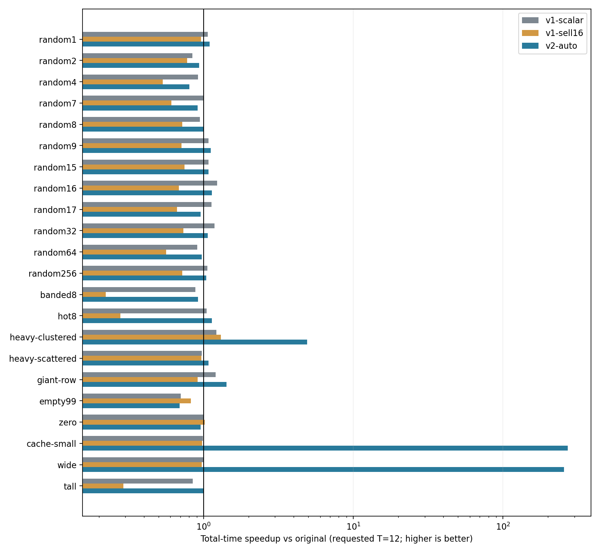
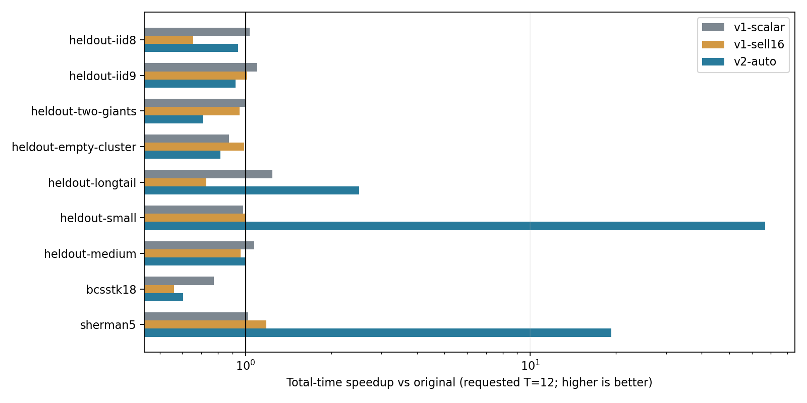

# v2 实验结果与适用边界

本轮代码分支直接从原始 master 创建，与 v1 为并列分支；原始、v1 与 v2 均在同批环境重新构建测量。旧实验原始数据没有改写。

## 1. 主目标：超大均匀矩阵，准备+执行+清理

矩阵仍为 1200 万行/列、9600 万 nnz。固定参数、原始自动向量化、相同绑定和 PASSIVE 等待；下表为独立进程中位数。P 与 E 的中位数分列，total 是每个进程 P+E+清理之和再取中位数，未用分项中位数替代逐次总时间。

| 线程 | R | 原始单次/ms | v2 单次/ms | v2 P/ms | 原始 total/s | v2 total/s | 总成本加速比 | 配对比值95%区间 |
| --- | --- | --- | --- | --- | --- | --- | --- | --- |
| 1 | 1 | 724.024 | 579.870 | 39.048 | 0.724024 | 0.622833 | 1.162× | [1.123, 1.258] |
| 1 | 9 | 747.643 | 605.347 | 43.531 | 6.728788 | 5.491452 | 1.225× | [1.139, 1.296] |
| 1 | 100 | 732.708 | 574.724 | 39.001 | 73.270766 | 57.511540 | 1.274× | [1.249, 1.332] |
| 12 | 1 | 115.645 | 88.798 | 12.373 | 0.115645 | 0.101293 | 1.142× | [1.067, 1.215] |
| 12 | 9 | 109.387 | 95.371 | 12.021 | 0.984484 | 0.870012 | 1.132× | [1.076, 1.265] |
| 12 | 100 | 108.516 | 94.056 | 12.308 | 10.851616 | 9.417815 | 1.152× | [1.085, 1.206] |
| 24 | 1 | 88.773 | 75.620 | 12.368 | 0.088773 | 0.087177 | 1.018× | [0.931, 1.049] |
| 24 | 9 | 90.156 | 80.120 | 12.275 | 0.811400 | 0.734880 | 1.104× | [1.052, 1.211] |
| 24 | 100 | 93.051 | 77.677 | 12.336 | 9.305138 | 7.780043 | 1.196× | [1.064, 1.342] |

区间针对 10 个相邻随机 AB/BA 进程对的加速比中位数，按进程对重采样 20000 次；点列为总时间中位数之比，两个统计量不要求完全相同。区间只反映本批过程样本，不覆盖宿主机/频率/跨机器变化。

**主目标判定：通过本轮预设门槛。** 原始最佳已测线程为 24，R=9 total=0.811400 s；v2 请求24线程 total=0.734880 s，时间降低 9.43%。门槛为至少降低5%且区间支持收益；这不表示所有输入都变快。

## 2. v1、novec 与匹配 CSR 对照

以下 R=9，原始/v2-auto 各10个独立进程，补充对照各5个，样本量不同已明确。v2-csr-rows 与 short8 使用同一验证、分区和 FP 模式，可用于分辨固定行展开；original-novec 为原始全构建禁循环/SLP向量化控制，不能把它的整个进程变化只归因于一个内核。

| 线程 | 后端 | 单次/ms | P/ms | total/s | 全进程 wall/s |
| --- | --- | --- | --- | --- | --- |
| 1 | original | 747.643 | 0.000 | 6.728788 | 17.38 |
| 1 | v1-scalar | 632.027 | 37.852 | 5.723963 | 16.21 |
| 1 | v1-sell16 | 593.414 | 374.447 | 5.738736 | 15.71 |
| 1 | v2-original | 754.437 | 0.000 | 6.789934 | 16.82 |
| 1 | original-novec | 620.847 | 0.000 | 5.587621 | 15.71 |
| 1 | v2-csr-rows | 602.381 | 39.323 | 5.460756 | 15.60 |
| 1 | v2-auto | 605.347 | 43.531 | 5.491452 | 15.89 |
| 12 | original | 109.387 | 0.000 | 0.984484 | 10.41 |
| 12 | v1-scalar | 109.688 | 37.902 | 1.025023 | 10.59 |
| 12 | v1-sell16 | 92.550 | 381.645 | 1.212639 | 11.03 |
| 12 | v2-original | 111.841 | 0.000 | 1.006568 | 10.44 |
| 12 | original-novec | 99.629 | 0.000 | 0.896657 | 10.37 |
| 12 | v2-csr-rows | 104.074 | 12.348 | 0.949018 | 10.47 |
| 12 | v2-auto | 95.371 | 12.021 | 0.870012 | 11.11 |
| 24 | original | 90.156 | 0.000 | 0.811400 | 10.61 |
| 24 | v1-scalar | 83.600 | 40.296 | 0.788685 | 10.38 |
| 24 | v1-sell16 | 75.654 | 373.702 | 1.054559 | 10.66 |
| 24 | v2-original | 89.053 | 0.000 | 0.801474 | 10.18 |
| 24 | original-novec | 85.314 | 0.000 | 0.767823 | 10.17 |
| 24 | v2-csr-rows | 81.450 | 12.580 | 0.744602 | 10.40 |
| 24 | v2-auto | 80.120 | 12.275 | 0.734880 | 10.43 |

csr.c SHA-256 与链接前 csr.o .text 在三个构建中一致，详见 csr-object-proof.json。它不能证明最终链接地址或缓存/调度状态一致，故不把 original 路径的差值直接叫包装开销。同二进制诊断另见第5节。

## 3. 原有极端输入：全部结果，不筛选胜者

同为请求12线程；v2-auto 对小任务可能实际执行1线程，具体见CSV。R通常为9，zero/cache-small/wide为100。表中为 prepare+execute+cleanup 的中位数；额外检查与调度成本均计入，正负结果同列。

| 输入 | R | original/ms | v1 scalar/ms | v1 SELL16/ms | v2 auto/ms | 原始/v2 | v2 实际选择 |
| --- | --- | --- | --- | --- | --- | --- | --- |
| random1 | 9 | 19.367 | 18.145 | 20.126 | 17.691 | 1.095× | csr/rows; T=12 |
| random2 | 9 | 24.633 | 29.338 | 31.641 | 26.412 | 0.933× | csr/rows; T=12 |
| random4 | 9 | 19.002 | 20.709 | 35.630 | 23.581 | 0.806× | csr/rows; T=12 |
| random7 | 9 | 20.124 | 20.135 | 32.966 | 22.065 | 0.912× | csr/rows; T=12 |
| random8 | 9 | 19.614 | 20.724 | 27.213 | 19.618 | 1.000× | short8/rows; T=12 |
| random9 | 9 | 22.608 | 21.006 | 31.701 | 20.214 | 1.118× | csr/rows; T=12 |
| random15 | 9 | 22.191 | 20.529 | 29.724 | 20.531 | 1.081× | csr/rows; T=12 |
| random16 | 9 | 21.269 | 17.257 | 31.166 | 18.765 | 1.133× | csr/rows; T=12 |
| random17 | 9 | 21.398 | 18.990 | 32.239 | 22.409 | 0.955× | csr/rows; T=12 |
| random32 | 9 | 22.224 | 18.738 | 30.276 | 20.864 | 1.065× | csr/rows; T=12 |
| random64 | 9 | 18.869 | 20.761 | 33.583 | 19.365 | 0.974× | csr/rows; T=12 |
| random256 | 9 | 23.869 | 22.514 | 33.203 | 22.924 | 1.041× | csr/rows; T=12 |
| banded8 | 9 | 4.116 | 4.680 | 18.571 | 4.486 | 0.917× | short8/rows; T=12 |
| hot8 | 9 | 4.912 | 4.684 | 17.625 | 4.319 | 1.137× | short8/rows; T=12 |
| heavy-clustered | 9 | 64.722 | 53.071 | 49.532 | 13.126 | 4.931× | csr/work; T=12 |
| heavy-scattered | 9 | 15.311 | 15.760 | 15.823 | 14.222 | 1.077× | csr/rows; T=12 |
| giant-row | 9 | 11.882 | 9.885 | 13.048 | 8.370 | 1.420× | merge/work; T=12 |
| empty99 | 9 | 4.252 | 6.049 | 5.167 | 6.156 | 0.691× | csr/rows; T=12 |
| zero | 100 | 19.308 | 19.331 | 18.932 | 20.151 | 0.958× | csr/rows; T=12 |
| cache-small | 100 | 18.050 | 18.200 | 18.422 | 0.067 | 271.322× | short8/rows; T=1 |
| wide | 100 | 18.150 | 18.100 | 18.612 | 0.071 | 255.854× | short8/rows; T=1 |
| tall | 9 | 13.465 | 15.947 | 46.237 | 13.450 | 1.001× | short8/rows; T=12 |

集中长尾、分散长尾、巨行和空行的 rows/work/merge 消融，以及 D=0/32/128 的预取对照全部保存在 summary.csv。集中长尾本来失衡，均匀散布的空行本来接近均衡，不能用同一种解释概括。巨行还必须与较强的 v1-pack 比较，不只和原始比较。

## 4. 保留集与真实矩阵

规则在保留集计时前冻结；没有用保留集成绩反向改阈值。新合成输入采用新种子并在整列范围无放回抽样，区别于原先每列区间一项；两个真实矩阵来自NIST。真实输入的f32转换及对称展开按两边相同设置执行。

| 输入 | 请求线程 | R | 原始 total/ms | v2 total/ms | 原始/v2 | v2选择/实际线程 |
| --- | --- | --- | --- | --- | --- | --- |
| heldout-iid8 | 1 | 9 | 57.183 | 49.451 | 1.156× | short8; T=1 |
| heldout-iid8 | 12 | 9 | 9.507 | 10.100 | 0.941× | short8; T=12 |
| heldout-iid8 | 24 | 9 | 10.168 | 10.424 | 0.975× | short8; T=24 |
| heldout-iid9 | 1 | 9 | 1.999 | 1.085 | 1.842× | csr; T=1 |
| heldout-iid9 | 12 | 9 | 2.514 | 2.726 | 0.922× | csr; T=12 |
| heldout-iid9 | 24 | 9 | 4.650 | 4.081 | 1.139× | csr; T=24 |
| heldout-two-giants | 1 | 9 | 2.934 | 2.569 | 1.142× | csr; T=1 |
| heldout-two-giants | 12 | 9 | 3.434 | 4.852 | 0.708× | merge; T=12 |
| heldout-two-giants | 24 | 9 | 5.483 | 8.759 | 0.626× | merge; T=24 |
| heldout-empty-cluster | 1 | 9 | 1.736 | 1.584 | 1.096× | csr; T=1 |
| heldout-empty-cluster | 12 | 9 | 2.789 | 3.418 | 0.816× | csr; T=12 |
| heldout-empty-cluster | 24 | 9 | 4.850 | 5.475 | 0.886× | csr; T=24 |
| heldout-longtail | 1 | 9 | 8.869 | 6.098 | 1.454× | csr; T=1 |
| heldout-longtail | 12 | 9 | 9.121 | 3.633 | 2.511× | csr; T=12 |
| heldout-longtail | 24 | 9 | 10.837 | 6.057 | 1.789× | csr; T=24 |
| heldout-small | 1 | 100 | 0.695 | 0.274 | 2.532× | short8; T=1 |
| heldout-small | 12 | 100 | 18.958 | 0.283 | 66.930× | short8; T=1 |
| heldout-small | 24 | 100 | 41.401 | 0.292 | 141.869× | short8; T=1 |
| heldout-medium | 1 | 9 | 0.485 | 0.294 | 1.650× | short8; T=1 |
| heldout-medium | 12 | 9 | 2.247 | 2.238 | 1.004× | short8; T=12 |
| heldout-medium | 24 | 9 | 4.158 | 3.976 | 1.046× | short8; T=24 |
| bcsstk18 | 1 | 9 | 0.973 | 1.166 | 0.835× | csr; T=1 |
| bcsstk18 | 12 | 9 | 2.062 | 3.419 | 0.603× | csr; T=12 |
| bcsstk18 | 24 | 9 | 4.007 | 5.444 | 0.736× | csr; T=24 |
| sherman5 | 1 | 9 | 0.159 | 0.142 | 1.123× | csr; T=1 |
| sherman5 | 12 | 9 | 2.406 | 0.125 | 19.263× | csr; T=1 |
| sherman5 | 24 | 9 | 4.155 | 0.166 | 25.083× | csr; T=1 |

[BCSSTK18来源](https://math.nist.gov/MatrixMarket/data/Harwell-Boeing/bcsstruc2/bcsstk18.html) 为结构工程对称矩阵，存80519项，展开149090项；[SHERMAN5来源](https://math.nist.gov/MatrixMarket/data/Harwell-Boeing/sherman/sherman5.html) 为油藏模拟非对称矩阵，20793项。文件、头部、下载地址与SHA保存在 matrices.json；MTX本体不随Git分发。

## 5. 同二进制、统一预热诊断

独立诊断程序链接改名后的固定v1模块、原始CSR及v2；它不是v2生产代码的一部分。每个后端统一预热一次，逐条件清零y并用轮转顺序平衡位置。5个后端轮转10轮，每个后端在每个位置恰好出现2次；其中v2通用CSR与short8使用相同FP模式。一个进程内的10轮有关联，不能当成10个独立进程或用来替代前述总成本实验。准备另记于JSON，下面只描述明确预热后的执行。

| 输入 | 线程 | original/ms | v1 scalar/ms | v1 SELL16/ms | v2/ms | v2通用CSR/ms |
| --- | --- | --- | --- | --- | --- | --- |
| random8 | 12 | 2.163 | 1.866 | 1.624 | 1.897 | 1.825 |
| heavy-clustered | 12 | 7.469 | 6.746 | 4.035 | 1.468 | 6.743 |
| giant-row | 12 | 0.969 | 0.875 | 0.960 | 0.524 | 0.884 |
| giant-row | 24 | 1.150 | 1.058 | 1.150 | 0.813 | 1.081 |
| large | 1 | 749.605 | 629.831 | 607.171 | 603.603 | 594.776 |
| large | 12 | 120.406 | 111.643 | 101.708 | 105.842 | 107.484 |
| large | 24 | 95.513 | 90.292 | 86.782 | 86.504 | 86.235 |

超大矩阵同二进制中，通用CSR/固定8项的稳态耗时比为：1线程 0.985×, 12线程 1.016×, 24线程 0.997×。本批均接近1，未证实固定8项展开具有稳定独立优势；整体相对原始的收益应结合直接CSR、局部标量组织和准备成本降低解释。诊断只有每配置一个进程，不能将微小差值外推为普遍结论。

本分支保留冻结的short8实验候选，且可强制通用CSR；默认全局入口仍是original。主目标数值门槛通过，不等于全输入自动策略已经验收。双巨行保留集的多线程退化说明，仅用最长行/平均事件比值选择merge还不够；准备与额外同步是需要继续细分的成本，当前没有线程等待分项计时。

巨行12线程R=9的较强对照：v1-pack总成本5.683 ms，v2-auto为8.370 ms。v2在这个输入上没有超过v1最强候选。

巨行的v1 SELL16可能因padding保护实际回退；每份诊断prepare记录含sell_selected及原因，不把该列的回退成绩算作SELL收益。诊断JSON的work记录是在计时后按本轮连续静态/显式分区规则复算的每线程nnz，并非线程耗时或硬件计数；没有将工作量模型当作新的性能测量。

## 6. 正确性、资源与可复现性

- 7轮核心配置各5368项检查（native 1/12/24，portable 12，ASan+UBSan 1/12/24）；另重跑v1的850项检查。CLI记录共165条，其中全量输出检查130组。
- 覆盖固定行长判断、空/尾部/零维、预取越界、分区覆盖、巨行跨多个线程、同一行起止片段、团队变化、malloc失败、非法参数、f64/整数/复数/pattern回退、NaN/Inf、消去、subnormal、非零y及变化x。
- 超大矩阵4条v2路径在12线程R=3下核对全部1200万输出，精确分数输入误差为0；真实矩阵用独立float64累加及随行长/绝对值和变化的误差界，不声称所有重组浮点求和逐位一致。
- BCSSTK18数值尺度较大，本批f32相对float64累加参考的最大绝对差为13929，原始与v2-auto相同且通过逐行误差界；SHERMAN5对应最大绝对差约0.000956296921。真实矩阵不能也写成“误差为0”。
- 正式/先导进程数：{'pilot': 180, 'screen': 650, 'heldout': 555, 'large': 180, 'large-controls': 75}，合计1640；原始输出、命令、环境和资源记录全部保留，未删除慢样本。
- 本批进程最大major faults=3；最大RSS=1924.50 MiB。全程RSS可能由更早COO+CSR阶段决定，不能以它衡量新增驻留数组。
- v2直接CSR没有整份格式副本，普通行额外矩阵数组0字节；merge为64*T字节scratch（24线程1536字节）。v1 SELL16仍额外约738 MiB，见逐次extra_bytes。
- 未锁定宿主负载/频率，没有本轮持续DRAM带宽或STREAM测量；不能宣称已到带宽上限。自动阈值不是通用最优，稍大缓存内输入仍可能更适合强制串行，已在先导记录中暴露。
- 主目标判定不替代输入适用性说明。没有将原有多线程、已有CSR或编译器自动SIMD算作新增贡献，没有缓存Ax、改变R或使用全局fast-math。

源码方法依据、许可与改编见核心 docs/v2.md 和 [v2调研](../../research/2026-10-25-spmv-v2/README.md)。完整复现入口见 [README](README.md)。
