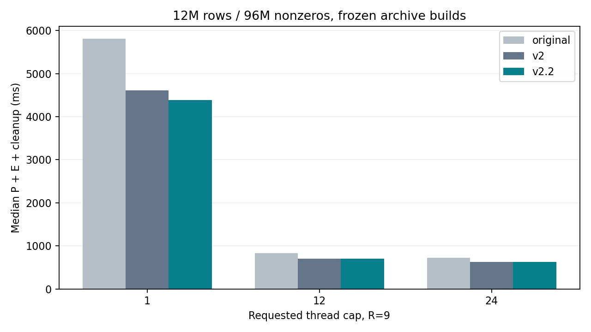

# v2.2 实验结果与适用范围

固定源码提交后进行三方实验，正式计时后没有调阈值或修改实现。v2.2直接基于v2，未合并v2.1。设计、实现、实验分别提交。

正式性能进程 **1960** 个，68份输入，320个相邻配对。主指标为逐进程P+E+D后取中位数，完整程序wall另列。

## 主大矩阵及共同门槛

原始R9最佳已测线程数 **24**，总成本 **0.726533s**。v2.2请求24线程时总成本 **0.629400s**，相对最佳原始时间变化 **-13.37%**；同批v2为 **0.625234s**，相对v2变化 **+0.67%**。

上限24同团队配对：原始/v2.2速度比中位数1.153，95%区间[1.090, 1.223]；v2/v2.2为1.002，区间[0.925, 1.057]。最佳原始团队若不是24，此区间不能外推到最佳团队。

**分支判定：共同门槛未通过，工作区切回v2；远端v2.2及全部结果保留。**

| 冻结门槛 | 本轮判断 |
| --- | --- |
| 主大矩阵对最佳已测原始至少5%收益且配对支持 | True |
| 主大矩阵相对v2中位退化≤3%，配对下界≥0.95 | False |
| 所有关键条件相对v2退化≤5% | True，最差heavy-clustered/T12：+0.86% |
| 小任务/空行/双巨行至少两类改善>5% | 3类（以T12各代表条件判断） |
| 旧/新T12组对原始的>5%退化计数均不增加 | True |

以上是共同工程门槛，不按单项亮点替换整体判定。correctness.json的233组检查全部通过。

相对v2的配对区间包含1，不能据此判定确定变慢；本轮回退的含义是尚未证明满足预设的不退化范围，不能将证据不足改写为计算内核已经退化。

| 请求T | R | 原始total/ms | v2 total/ms | v2.2 total/ms | v2.2 P/ms | 路径/实际T |
| --- | --- | ---: | ---: | ---: | ---: | --- |
| 1 | 9 | 5812.083 | 4612.709 | 4385.196 | 35.590 | v2-large/1 |
| 12 | 9 | 829.721 | 702.929 | 707.623 | 11.370 | v2-large/12 |
| 24 | 1 | 79.615 | 80.878 | 80.433 | 11.670 | v2-large/24 |
| 24 | 9 | 726.533 | 625.234 | 629.400 | 11.468 | v2-large/24 |
| 24 | 100 | 7892.755 | 6929.368 | 6941.608 | 11.455 | v2-large/24 |

主R9/T24全程序wall中位数：原始10.13s，v2 9.75s，v2.2 9.54s。wall包含文本读取和格式转换，不能把SpMV阶段的加速率当作全程序加速率。

关键/主条件每个控制10个进程，候选来自两组共20个。条件中位数与各自10对的速度比中位数是不同估计。R1/R100、T1以及原始T2/4/8各为5进程补充，不与配对样本混合。

## 关键条件：相对原始和v2都报告

| 输入 | 上限T | R | 原始/ms | v2/ms | v2.2/ms | 相对原始时间 | 相对v2时间 | 路径/实际T |
| --- | --- | --- | ---: | ---: | ---: | ---: | ---: | --- |
| bcsstk18 | 12 | 9 | 1.653 | 2.194 | 0.793 | -52.04% | -63.86% | small-serial/1 |
| bcsstk18 | 24 | 9 | 3.075 | 4.279 | 0.782 | -74.56% | -81.72% | small-serial/1 |
| empty99 | 12 | 9 | 3.364 | 3.902 | 3.120 | -7.25% | -20.06% | empty-runs/12 |
| empty99 | 24 | 9 | 4.410 | 5.582 | 4.369 | -0.92% | -21.73% | empty-runs/24 |
| giant-row | 12 | 9 | 7.730 | 5.598 | 5.007 | -35.23% | -10.55% | v2-rules-fast-validation/12 |
| giant-row | 24 | 9 | 9.284 | 8.290 | 7.313 | -21.23% | -11.78% | v2-rules-fast-validation/24 |
| heavy-clustered | 12 | 9 | 56.387 | 13.811 | 13.930 | -75.30% | +0.86% | v2-rules-fast-validation/12 |
| heavy-clustered | 24 | 9 | 56.935 | 13.027 | 12.593 | -77.88% | -3.34% | v2-rules-fast-validation/24 |
| heldout-empty-cluster | 12 | 9 | 2.034 | 2.228 | 1.927 | -5.24% | -13.48% | empty-runs/12 |
| heldout-empty-cluster | 24 | 9 | 3.510 | 4.300 | 3.455 | -1.58% | -19.66% | empty-runs/24 |
| heldout-two-giants | 12 | 9 | 2.678 | 3.679 | 1.708 | -36.24% | -53.58% | few-giants/2 |
| heldout-two-giants | 24 | 9 | 4.171 | 6.897 | 1.879 | -54.96% | -72.76% | few-giants/2 |
| wide | 12 | 100 | 14.676 | 0.056 | 0.054 | -99.63% | -2.36% | small-serial/1 |
| wide | 24 | 100 | 29.320 | 0.056 | 0.054 | -99.81% | -2.39% | small-serial/1 |

## 旧回归集及新保留集

旧52输入T12：v2（快超过5% 22，±5%内 8，慢超过5% 22），v2.2（快超过5% 36，±5%内 8，慢超过5% 8）。新16输入T12：v2（快超过5% 4，±5%内 3，慢超过5% 9），v2.2（快超过5% 11，±5%内 2，慢超过5% 3）。计数均相对原始；不能当作逐例显著性或工作负载权重。

直接对v2，旧T12：快超过5% 31，±5%内 13，慢超过5% 8；新T12：快超过5% 10，±5%内 6，慢超过5% 0。

旧zero/cache-small/wide使用R100，其他旧输入R9；新输入按存储项数<20000时R100，其余R9。对称真实输入实际运算项数以展开后计数为准。所有同条件三方的R、输入及OpenMP环境一致。

| 组 | 输入 | T | R | 原始/ms | v2/ms | v2.2/ms | 相对原始时间 | 相对v2时间 | 路径/实际T |
| --- | --- | --- | --- | ---: | ---: | ---: | ---: | ---: | --- |
| heldout | bcsstk14 | 12 | 9 | 1.681 | 1.762 | 0.260 | -84.56% | -85.27% | small-serial/1 |
| heldout | bcsstk14 | 24 | 9 | 3.314 | 3.376 | 0.262 | -92.09% | -92.24% | small-serial/1 |
| heldout | bcsstk15 | 12 | 9 | 1.669 | 2.229 | 0.480 | -71.23% | -78.46% | small-serial/1 |
| heldout | bcsstk15 | 24 | 9 | 3.338 | 4.605 | 0.463 | -86.14% | -89.95% | small-serial/1 |
| heldout | sherman1 | 12 | 100 | 15.314 | 0.178 | 0.181 | -98.82% | +1.60% | small-serial/1 |
| heldout | sherman1 | 24 | 100 | 32.298 | 0.182 | 0.179 | -99.45% | -2.06% | small-serial/1 |
| heldout | v22-banded | 12 | 9 | 3.294 | 3.530 | 3.468 | +5.27% | -1.76% | v2-rules-fast-validation/12 |
| heldout | v22-banded | 24 | 9 | 4.413 | 5.117 | 4.575 | +3.67% | -10.59% | v2-rules-fast-validation/24 |
| heldout | v22-empty50 | 12 | 9 | 2.125 | 2.705 | 2.578 | +21.32% | -4.71% | v2-rules-fast-validation/12 |
| heldout | v22-empty50 | 24 | 9 | 3.593 | 4.765 | 4.212 | +17.23% | -11.61% | v2-rules-fast-validation/24 |
| heldout | v22-empty90 | 12 | 9 | 3.513 | 2.585 | 2.343 | -33.31% | -9.38% | v2-rules-fast-validation/12 |
| heldout | v22-empty90 | 24 | 9 | 4.348 | 4.821 | 3.794 | -12.75% | -21.31% | v2-rules-fast-validation/24 |
| heldout | v22-empty99 | 12 | 9 | 2.458 | 2.957 | 3.030 | +23.28% | +2.49% | v2-rules-fast-validation/12 |
| heldout | v22-empty99 | 24 | 9 | 3.814 | 5.036 | 4.400 | +15.37% | -12.62% | v2-rules-fast-validation/24 |
| heldout | v22-iid5 | 12 | 9 | 2.693 | 3.274 | 2.518 | -6.51% | -23.10% | v2-rules-fast-validation/12 |
| heldout | v22-iid5 | 24 | 9 | 3.904 | 4.897 | 3.987 | +2.14% | -18.58% | v2-rules-fast-validation/24 |
| heldout | v22-iid8 | 12 | 9 | 7.415 | 7.431 | 6.647 | -10.36% | -10.55% | v2-rules-fast-validation/12 |
| heldout | v22-iid8 | 24 | 9 | 8.415 | 8.325 | 7.429 | -11.72% | -10.77% | v2-rules-fast-validation/24 |
| heldout | v22-longtail | 12 | 9 | 14.046 | 4.297 | 4.226 | -69.91% | -1.66% | v2-rules-fast-validation/12 |
| heldout | v22-longtail | 24 | 9 | 16.110 | 5.723 | 4.906 | -69.55% | -14.28% | v2-rules-fast-validation/24 |
| heldout | v22-resident-high | 12 | 9 | 1.836 | 2.326 | 1.823 | -0.73% | -21.64% | v2-rules-fast-validation/12 |
| heldout | v22-resident-high | 24 | 9 | 3.460 | 4.489 | 3.472 | +0.36% | -22.64% | v2-rules-fast-validation/24 |
| heldout | v22-resident-low | 12 | 9 | 1.780 | 2.397 | 0.756 | -57.53% | -68.46% | small-serial/1 |
| heldout | v22-resident-low | 24 | 9 | 3.324 | 4.387 | 0.770 | -76.83% | -82.44% | small-serial/1 |
| heldout | v22-six-giants | 12 | 9 | 2.183 | 2.690 | 2.168 | -0.68% | -19.41% | v2-rules-fast-validation/12 |
| heldout | v22-six-giants | 24 | 9 | 3.942 | 7.422 | 6.077 | +54.15% | -18.13% | v2-rules-fast-validation/24 |
| heldout | v22-two-giants | 12 | 9 | 2.946 | 3.979 | 2.128 | -27.76% | -46.51% | few-giants/2 |
| heldout | v22-two-giants | 24 | 9 | 4.448 | 6.992 | 2.416 | -45.68% | -65.44% | few-giants/2 |
| heldout | v22-zero | 12 | 100 | 17.889 | 18.500 | 1.443 | -91.94% | -92.20% | zero-runs/1 |
| heldout | v22-zero | 24 | 100 | 32.014 | 34.636 | 1.394 | -95.65% | -95.98% | zero-runs/1 |
| heldout | west0655 | 12 | 100 | 14.999 | 0.134 | 0.130 | -99.13% | -2.46% | small-serial/1 |
| heldout | west0655 | 24 | 100 | 29.731 | 0.134 | 0.133 | -99.55% | -0.88% | small-serial/1 |
| screen | banded8 | 12 | 9 | 3.426 | 4.222 | 3.895 | +13.69% | -7.74% | v2-rules-fast-validation/12 |
| screen | bcsstk17 | 12 | 9 | 1.999 | 2.305 | 2.033 | +1.71% | -11.78% | v2-rules-fast-validation/12 |
| screen | cache-small | 12 | 100 | 14.679 | 0.053 | 0.053 | -99.64% | -0.66% | small-serial/1 |
| screen | heavy-scattered | 12 | 9 | 15.866 | 14.604 | 15.937 | +0.45% | +9.12% | v2-rules-fast-validation/12 |
| screen | heldout-iid8 | 12 | 9 | 9.660 | 8.348 | 8.928 | -7.58% | +6.94% | v2-rules-fast-validation/12 |
| screen | heldout-iid9 | 12 | 9 | 1.717 | 1.795 | 1.789 | +4.17% | -0.36% | v2-rules-fast-validation/12 |
| screen | heldout-longtail | 12 | 9 | 7.404 | 3.669 | 3.051 | -58.79% | -16.84% | v2-rules-fast-validation/12 |
| screen | heldout-medium | 12 | 9 | 1.665 | 1.711 | 0.231 | -86.15% | -86.52% | small-serial/1 |
| screen | heldout-small | 12 | 9 | 1.602 | 0.024 | 0.026 | -98.38% | +6.00% | small-serial/1 |
| screen | hot8 | 12 | 9 | 3.622 | 4.157 | 3.653 | +0.86% | -12.12% | v2-rules-fast-validation/12 |
| screen | new-banded | 12 | 9 | 2.819 | 3.130 | 2.807 | -0.42% | -10.31% | v2-rules-fast-validation/12 |
| screen | new-eight-giants | 12 | 9 | 2.254 | 2.678 | 2.196 | -2.55% | -17.98% | v2-rules-fast-validation/12 |
| screen | new-empty-cluster | 12 | 9 | 2.318 | 2.363 | 2.178 | -6.03% | -7.82% | empty-runs/12 |
| screen | new-empty-periodic | 12 | 9 | 2.505 | 2.832 | 2.133 | -14.85% | -24.69% | empty-runs/12 |
| screen | new-empty-random | 12 | 9 | 2.310 | 3.068 | 3.144 | +36.10% | +2.47% | v2-rules-fast-validation/12 |
| screen | new-hot4 | 12 | 9 | 2.489 | 2.481 | 2.589 | +4.03% | +4.37% | v2-rules-fast-validation/12 |
| screen | new-iid7 | 12 | 9 | 2.551 | 3.227 | 2.884 | +13.05% | -10.63% | v2-rules-fast-validation/12 |
| screen | new-iid8 | 12 | 9 | 5.768 | 5.689 | 6.771 | +17.39% | +19.02% | v2-rules-fast-validation/12 |
| screen | new-longtail | 12 | 9 | 11.026 | 3.916 | 3.431 | -68.89% | -12.39% | v2-rules-fast-validation/12 |
| screen | new-medium | 12 | 9 | 1.746 | 2.281 | 0.481 | -72.44% | -78.90% | small-serial/1 |
| screen | new-near-prepare | 12 | 9 | 1.639 | 2.184 | 0.436 | -73.38% | -80.02% | small-serial/1 |
| screen | new-near-serial | 12 | 9 | 1.621 | 1.719 | 0.111 | -93.16% | -93.55% | small-serial/1 |
| screen | new-one-mid | 12 | 9 | 4.281 | 4.001 | 2.347 | -45.18% | -41.35% | few-giants/2 |
| screen | new-small | 12 | 9 | 1.685 | 0.071 | 0.078 | -95.39% | +9.95% | small-serial/1 |
| screen | new-two-adjacent | 12 | 9 | 3.528 | 3.847 | 1.942 | -44.95% | -49.51% | few-giants/2 |
| screen | new-zero | 12 | 9 | 1.696 | 2.185 | 0.192 | -88.65% | -91.19% | zero-runs/1 |
| screen | random1 | 12 | 9 | 16.147 | 13.810 | 14.690 | -9.02% | +6.37% | v2-rules-fast-validation/12 |
| screen | random15 | 12 | 9 | 15.240 | 20.649 | 20.640 | +35.43% | -0.04% | v2-rules-fast-validation/12 |
| screen | random16 | 12 | 9 | 19.828 | 17.527 | 17.805 | -10.20% | +1.59% | v2-rules-fast-validation/12 |
| screen | random17 | 12 | 9 | 18.556 | 18.692 | 17.456 | -5.93% | -6.61% | v2-rules-fast-validation/12 |
| screen | random2 | 12 | 9 | 21.313 | 26.239 | 26.994 | +26.66% | +2.88% | v2-rules-fast-validation/12 |
| screen | random256 | 12 | 9 | 18.972 | 20.515 | 20.281 | +6.90% | -1.14% | v2-rules-fast-validation/12 |
| screen | random32 | 12 | 9 | 18.500 | 19.399 | 16.086 | -13.05% | -17.08% | v2-rules-fast-validation/12 |
| screen | random4 | 12 | 9 | 20.327 | 21.373 | 19.830 | -2.45% | -7.22% | v2-rules-fast-validation/12 |
| screen | random64 | 12 | 9 | 20.233 | 15.188 | 16.847 | -16.73% | +10.93% | v2-rules-fast-validation/12 |
| screen | random7 | 12 | 9 | 17.429 | 20.946 | 19.421 | +11.43% | -7.28% | v2-rules-fast-validation/12 |
| screen | random8 | 12 | 9 | 24.884 | 16.976 | 20.327 | -18.31% | +19.74% | v2-rules-fast-validation/12 |
| screen | random9 | 12 | 9 | 23.096 | 20.384 | 17.440 | -24.49% | -14.44% | v2-rules-fast-validation/12 |
| screen | saylr4 | 12 | 9 | 1.548 | 0.116 | 0.120 | -92.24% | +3.14% | small-serial/1 |
| screen | sherman3 | 12 | 9 | 1.633 | 0.129 | 0.114 | -93.02% | -11.50% | small-serial/1 |
| screen | sherman5 | 12 | 9 | 1.694 | 0.098 | 0.095 | -94.40% | -3.41% | small-serial/1 |
| screen | tall | 12 | 9 | 14.876 | 13.403 | 11.324 | -23.88% | -15.51% | v2-large/12 |
| screen | west0479 | 12 | 9 | 1.475 | 0.013 | 0.012 | -99.19% | -9.17% | small-serial/1 |
| screen | zero | 12 | 100 | 17.127 | 16.907 | 0.526 | -96.93% | -96.89% | zero-runs/1 |

### 仍然存在的退化与新增负例

退化总数减少不等于逐例支配。下表列出T12相对v2最慢的最多10个条件；其中准备和执行分别列出，避免将新验证循环的开销混称为计算内核变化。这里使用阶段中位数，P中位数+E中位数未必等于逐进程总成本中位数。

| 输入 | R | 相对原始时间 | 相对v2时间 | v2 P/ms | v2 E/ms | v2.2 P/ms | v2.2 E/ms | 路径 |
| --- | --- | ---: | ---: | ---: | ---: | ---: | ---: | --- |
| random8 | 9 | -18.31% | +19.74% | 0.816 | 16.160 | 0.825 | 19.477 | v2-rules-fast-validation |
| new-iid8 | 9 | +17.39% | +19.02% | 0.625 | 4.997 | 0.410 | 6.267 | v2-rules-fast-validation |
| random64 | 9 | -16.73% | +10.93% | 0.823 | 14.379 | 0.622 | 16.237 | v2-rules-fast-validation |
| new-small | 9 | -95.39% | +9.95% | 0.012 | 0.059 | 0.012 | 0.066 | small-serial |
| heavy-scattered | 9 | +0.45% | +9.12% | 0.953 | 13.651 | 0.579 | 15.357 | v2-rules-fast-validation |
| heldout-iid8 | 9 | -7.58% | +6.94% | 0.616 | 7.732 | 0.360 | 8.587 | v2-rules-fast-validation |
| random1 | 9 | -9.02% | +6.37% | 0.948 | 12.862 | 1.202 | 13.474 | v2-rules-fast-validation |
| heldout-small | 9 | -98.38% | +6.00% | 0.005 | 0.019 | 0.005 | 0.021 | small-serial |
| new-hot4 | 9 | +4.03% | +4.37% | 0.622 | 1.886 | 0.429 | 2.169 | v2-rules-fast-validation |
| saylr4 | 9 | -92.24% | +3.14% | 0.011 | 0.106 | 0.011 | 0.109 | small-serial |

T12中v2原本未超过5%退化、v2.2却超过的条件：new-iid8。这是冻结计数门槛允许出现的个例，不能从总数下降推断每个输入都改善。

普通循环验证节省启动团队的成本，却仍要逐项扫描列号；接近大任务界限的输入可能付出更高准备时间。非空行索引仍需完整验证、分配索引、写空行输出；高空行比例本身不保证回本。random8和new-iid8的回退主要出现在E，不能归咎于准备时间：它们沿用旧内核，但本轮尚未用硬件计数器或更多配对区分验证前缀的缓存影响、链接布局和系统波动。不能直接断言都是噪声，也不宣称已定位指令原因。

### 新空行输入的漏选：64点均匀抽样存在结构混叠

代码只把抽样作为是否提前分配索引的提示，随后仍全量检查；但提示漏选时不会在全量检查后重试分配。因此它不破坏正确性，却会遗漏优化机会。结构复算和实际route日志见sampling-diagnosis.json；没有据此改代码或补调阈值。

| 新输入 | 真实空行率 | 64点抽到的空行 | 是否触发索引分配 | 实际路径 |
| --- | ---: | --- | --- | --- |
| v22-empty99 | 98.9999% | 56/64（87.5000%） | False | v2-rules-fast-validation |
| v22-empty90 | 90.0003% | 57/64（89.0625%） | False | v2-rules-fast-validation |

特别是新99%空行输入，均匀取样位置与每100行一个非空行的周期发生混叠，只看到87.5%空行；90%聚集输入的64点取整也只看到89.0625%。两者均低于分配提示门槛。不能把这两份auto成绩当作empty-runs内核的实测成绩；它们实质上走普通CSR/work。这是本版可复现的策略覆盖缺口。

## 消融与同二进制诊断

消融每项5个额外进程，与主组处于不同时间段，小差值不能直接视为因果贡献。empty-off仅关闭非零矩阵索引，零矩阵专用路径仍在；显式serial和policy=v2委托旧v2。

| 输入 | 变体 | T | R | P/ms | E/ms | total/ms | 实际T |
| --- | --- | --- | --- | ---: | ---: | ---: | --- |
| bcsstk18 | v22-empty-off | 12 | 9 | 0.057 | 0.735 | 0.799 | 1 |
| bcsstk18 | v22-empty-on | 12 | 9 | 0.073 | 0.854 | 0.927 | 1 |
| bcsstk18 | v22-serial | 12 | 9 | 0.060 | 0.744 | 0.814 | 1 |
| bcsstk18 | v22-v2 | 12 | 9 | 0.566 | 1.651 | 2.190 | 12 |
| empty99 | v22-empty-off | 12 | 9 | 0.894 | 3.603 | 4.527 | 12 |
| empty99 | v22-empty-on | 12 | 9 | 0.894 | 2.405 | 3.279 | 12 |
| empty99 | v22-serial | 12 | 9 | 0.673 | 14.543 | 15.165 | 1 |
| empty99 | v22-v2 | 12 | 9 | 0.656 | 3.572 | 4.182 | 12 |
| heldout-empty-cluster | v22-empty-off | 12 | 9 | 0.113 | 1.756 | 1.869 | 12 |
| heldout-empty-cluster | v22-empty-on | 12 | 9 | 0.126 | 1.862 | 2.016 | 12 |
| heldout-empty-cluster | v22-serial | 12 | 9 | 0.094 | 1.001 | 1.095 | 1 |
| heldout-empty-cluster | v22-v2 | 12 | 9 | 0.632 | 1.753 | 2.428 | 12 |
| heldout-two-giants | v22-empty-off | 12 | 9 | 0.108 | 1.701 | 1.812 | 2 |
| heldout-two-giants | v22-empty-on | 12 | 9 | 0.124 | 1.716 | 1.840 | 2 |
| heldout-two-giants | v22-serial | 12 | 9 | 0.101 | 1.801 | 1.902 | 1 |
| heldout-two-giants | v22-v2 | 12 | 9 | 0.570 | 3.128 | 3.718 | 12 |
| wide | v22-empty-off | 12 | 100 | 0.001 | 0.056 | 0.057 | 1 |
| wide | v22-empty-on | 12 | 100 | 0.002 | 0.065 | 0.067 | 1 |
| wide | v22-serial | 12 | 100 | 0.003 | 0.059 | 0.062 | 1 |
| wide | v22-v2 | 12 | 100 | 0.003 | 0.055 | 0.058 | 1 |
| zero | v22-empty-off | 12 | 100 | 0.085 | 0.410 | 0.498 | 1 |
| zero | v22-empty-on | 12 | 100 | 0.084 | 0.435 | 0.521 | 1 |
| zero | v22-serial | 12 | 100 | 0.079 | 6.546 | 6.625 | 1 |
| zero | v22-v2 | 12 | 100 | 0.601 | 15.483 | 16.084 | 12 |

同二进制使用原始csr.o、未改的v2内核和新v2.2计划，生产浮点方式保留；六个后端各一次公平预热，12轮轮转，每个后端在各顺序位出现两次。每条件只有一个独立进程。下表仅为R次E的进程内中位数，正式结论仍以独立进程P+E+D为准。

| 输入 | 后端 | P/ms（一次） | E/ms（轮转中位数） | 实际T |
| --- | --- | ---: | ---: | --- |
| heldout-two-giants | original | 0.000 | 2.735 | 12 |
| heldout-two-giants | v2-auto | 0.586 | 3.138 | 12 |
| heldout-two-giants | v22-auto | 0.101 | 1.614 | 2 |
| heldout-two-giants | v2-csr | 1.205 | 2.678 | 12 |
| heldout-two-giants | v22-policy-v2 | 0.567 | 3.192 | 12 |
| heldout-two-giants | v22-empty-off | 0.103 | 1.666 | 2 |
| giant-row | original | 0.000 | 7.952 | 12 |
| giant-row | v2-auto | 0.596 | 4.383 | 12 |
| giant-row | v22-auto | 0.405 | 4.394 | 12 |
| giant-row | v2-csr | 0.595 | 7.578 | 12 |
| giant-row | v22-policy-v2 | 0.617 | 4.426 | 12 |
| giant-row | v22-empty-off | 0.428 | 4.301 | 12 |
| empty99 | original | 0.000 | 3.090 | 12 |
| empty99 | v2-auto | 0.651 | 3.060 | 12 |
| empty99 | v22-auto | 0.913 | 2.232 | 12 |
| empty99 | v2-csr | 0.682 | 2.956 | 12 |
| empty99 | v22-policy-v2 | 0.640 | 3.011 | 12 |
| empty99 | v22-empty-off | 0.909 | 3.032 | 12 |
| bcsstk18 | original | 0.000 | 1.765 | 12 |
| bcsstk18 | v2-auto | 0.600 | 1.754 | 12 |
| bcsstk18 | v22-auto | 0.058 | 0.730 | 1 |
| bcsstk18 | v2-csr | 0.579 | 1.716 | 12 |
| bcsstk18 | v22-policy-v2 | 0.597 | 1.715 | 12 |
| bcsstk18 | v22-empty-off | 0.056 | 0.548 | 1 |
| wide | original | 0.000 | 15.399 | 12 |
| wide | v2-auto | 0.003 | 0.046 | 1 |
| wide | v22-auto | 0.001 | 0.045 | 1 |
| wide | v2-csr | 0.002 | 15.366 | 12 |
| wide | v22-policy-v2 | 0.008 | 0.046 | 1 |
| wide | v22-empty-off | 0.001 | 0.046 | 1 |
| large | original | 0.000 | 704.010 | 24 |
| large | v2-auto | 10.446 | 593.229 | 24 |
| large | v22-auto | 10.429 | 595.869 | 24 |
| large | v2-csr | 9.490 | 619.533 | 24 |
| large | v22-policy-v2 | 10.228 | 599.460 | 24 |
| large | v22-empty-off | 10.215 | 584.233 | 24 |

## 图表

[旧52输入T12速度比图](figures/old-T12.png) · [新16输入T12速度比图](figures/new-T12.png)。速度比图中大于1表示快于原始，图中请求线程上限相同、实际团队允许不同。

## 正确性、资源及结论边界

- 新v2.2每配置1007项检查，旧v2每配置5368项回归；native T1/12/24、portable T12、ASan+UBSan T1/12/24共七配置。覆盖变化x/values、非零初始y、R0/1/3、特殊浮点、分配/预算回退、非法结构及实际团队变化。
- 68输入完整向量检查：合成四分之一值与全1向量使用精确参考，真实矩阵将输入转f32后由独立float64参考及逐行误差界核验。真实输出文本用50位精度，避免固定9位将极小数舍零。另含10组类型/对称兼容检查。不声称所有真实误差为0。
- 180个独立CLI校准观察在核心提交前完成，与正式保留输入分离。没有运行时外部profile，没有缓存Ax；每次重复均读取实时x和矩阵值。大任务委托旧v2，不能把该部分同批浮动归因于新内核算力提升。
- 正式进程最大RSS 1924.50 MiB，最大major faults 0，新增元数据最大 320576 B。RSS含更早的COO/CSR峰值，不等同于新增表大小。
- 原始自动向量化保留，csr.c和spmv_v2.c源码未改。独立csr.o代码段字节比对只能证明重定位前代码段一致，不能证明链接布局、调度或缓存状态一致；相关证据另存。
- 未锁定宿主机频率/后台负载，未测DRAM带宽或硬件缓存失效，不能将性能波动或工作集字节数冒充硬件瓶颈证据。PASSIVE及本机的线程选择不保证适合其他环境。

全部负结果、命令、计时和资源记录均保留。共同门槛判定见decision.json；复现和数据来源见README.md。
