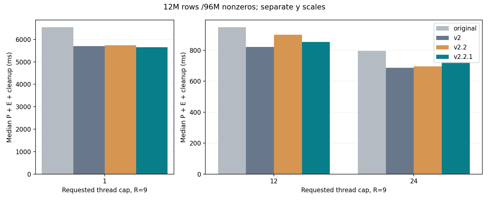
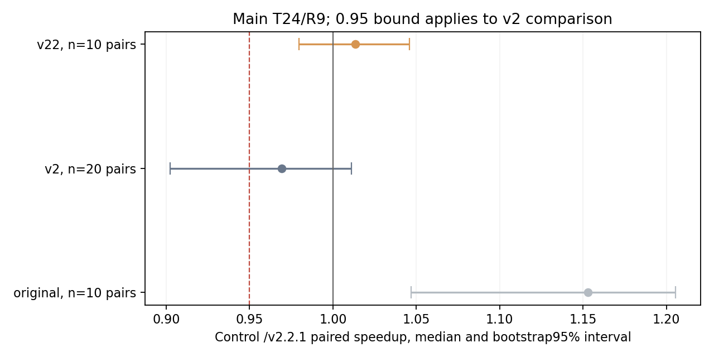

# v2.2.1四版本实验结果

先推送设计f6e247a，再从v2.2创建分支并推送实现dfb4ae2；随后固定四个提交计时。实现不来自v2或v2.1。正式结果出现后没有更改代码、阈值、输入、样本或准入门槛。

正式进程3369，80份输入，820个相邻随机进程对；另有90个提交前独立CLI校准观察及489组完整向量/兼容核验。

## 最终判断

**共同门槛未通过，核心工作区恢复optimization/v2；远端v2.2.1保留。** 未合并master，没有重写历史。

| 预先约定的门槛 | 是否通过 |
| --- | --- |
| 正确性与安全检查 | 通过 |
| 主矩阵对最佳已测原始至少5%收益，且配对支持 | 通过 |
| 主矩阵对v2中位退化≤3%，速度比区间下界≥0.95 | 未通过 |
| 主矩阵对v2.2中位退化≤3% | 未通过 |
| 原7个关键条件对v2.2不新增超过5%中位退化 | 未通过 |
| 两份漏选实际启用索引，T12至少一份改善>5%，另一份退化≤5% | 未通过 |
| 旧/新T12对原始的退化计数均不多于v2.2 | 通过 |
| 此前8个退化条件无确认的>5%对v2退化 | 通过 |

任一共同门槛失败或证据不足即回退；区间包含1时不能称为确定变慢，也不能声称证明了等效。不按某个亮点替换整体判定。

## 主大矩阵：总成本与样本区间

R9原始最佳已测线程24，total=0.795747s。本版T24中位total=0.723520s，相对最佳原始变化-9.08%，相对v2 +5.53%，相对v2.2 +4.09%。

| 请求T | R | 原始/ms | v2/ms | v2.2/ms | v2.2.1/ms | 本版P/ms | 本版执行器/实际T |
| --- | --- | ---: | ---: | ---: | ---: | ---: | --- |
| 1 | 9 | 6537.596 | 5696.099 | 5740.380 | 5649.693 | 36.554 | v2/1 |
| 12 | 9 | 947.490 | 821.804 | 899.400 | 853.604 | 11.664 | v2/12 |
| 24 | 1 | 88.528 | 83.984 | 83.402 | 87.732 | 11.734 | v2/24 |
| 24 | 9 | 795.746 | 685.634 | 695.074 | 723.520 | 11.269 | v2/24 |
| 24 | 100 | 8976.025 | 7872.881 | 8049.977 | 7844.326 | 11.349 | v2/24 |

| 主T24控制 | 配对数 | 控制/本版配对速度比中位数 | 95%区间 |
| --- | --- | ---: | --- |
| original | 10 | 1.153 | [1.047, 1.205] |
| v2 | 20 | 0.969 | [0.902, 1.011] |
| v22 | 10 | 1.013 | [0.980, 1.046] |

表中本版使用40个候选样本，中位数之比与对应10/20对速度比中位数不同。各区间仅使用对应进程对。若最佳原始团队不是24，T24配对区间不能外推至该最佳团队。

主条件全程序wall中位数：original 9.87s，v2 9.73s，v22 9.53s，v221 9.63s。它含MTX读取和转换，不能把SpMV阶段变化率当作全程序变化率。大任务复用旧v2，观察到的差值不能直接归为新算术内核收益。

## 关键输入与此前八份退化输入

| 输入 | T | R | 原始/ms | v2/ms | v2.2/ms | 本版/ms | 相对v2 | 相对v2.2 | 路径/实际T |
| --- | --- | --- | ---: | ---: | ---: | ---: | ---: | ---: | --- |
| bcsstk18 | 12 | 9 | 1.706 | 2.291 | 0.817 | 0.881 | -61.55% | +7.83% | resident-direct/1 |
| bcsstk18 | 24 | 9 | 3.253 | 4.484 | 0.811 | 0.869 | -80.62% | +7.13% | resident-direct/1 |
| empty99 | 12 | 9 | 3.692 | 4.019 | 3.251 | 3.388 | -15.69% | +4.23% | empty-runs/12 |
| empty99 | 24 | 9 | 4.752 | 5.712 | 4.571 | 4.720 | -17.37% | +3.25% | empty-runs/24 |
| giant-row | 12 | 9 | 8.687 | 5.852 | 5.267 | 5.180 | -11.49% | -1.65% | v2-local-direct/12 |
| giant-row | 24 | 9 | 9.965 | 8.661 | 7.605 | 7.622 | -11.99% | +0.22% | v2-local-direct/24 |
| heavy-clustered | 12 | 9 | 57.757 | 13.586 | 13.839 | 13.305 | -2.07% | -3.86% | v2-local-direct/12 |
| heavy-clustered | 24 | 9 | 59.117 | 12.999 | 12.162 | 12.286 | -5.48% | +1.02% | v2-local-direct/24 |
| heavy-scattered | 12 | 9 | 13.055 | 13.973 | 12.479 | 13.194 | -5.58% | +5.73% | v2-local-direct/12 |
| heldout-empty-cluster | 12 | 9 | 2.099 | 2.364 | 2.021 | 1.823 | -22.90% | -9.82% | empty-runs/12 |
| heldout-empty-cluster | 24 | 9 | 3.595 | 4.636 | 3.559 | 3.362 | -27.49% | -5.53% | empty-runs/24 |
| heldout-iid8 | 12 | 9 | 8.890 | 8.510 | 8.230 | 7.952 | -6.55% | -3.38% | v2-local-direct/12 |
| heldout-small | 12 | 9 | 1.588 | 0.025 | 0.024 | 0.024 | -2.86% | +0.06% | resident-direct/1 |
| heldout-two-giants | 12 | 9 | 2.712 | 3.847 | 1.794 | 1.787 | -53.54% | -0.36% | few-giants-direct/2 |
| heldout-two-giants | 24 | 9 | 4.224 | 7.167 | 1.862 | 1.911 | -73.34% | +2.62% | few-giants-direct/2 |
| new-iid8 | 12 | 9 | 5.975 | 5.698 | 5.314 | 5.569 | -2.27% | +4.79% | v2-local-direct/12 |
| new-small | 12 | 9 | 1.635 | 0.072 | 0.073 | 0.073 | +1.67% | +0.13% | resident-direct/1 |
| random1 | 12 | 9 | 15.124 | 14.185 | 14.642 | 14.651 | +3.28% | +0.06% | v2-local-direct/12 |
| random64 | 12 | 9 | 18.657 | 16.719 | 16.638 | 16.814 | +0.57% | +1.06% | v2-local-direct/12 |
| random8 | 12 | 9 | 20.658 | 17.377 | 18.169 | 17.826 | +2.59% | -1.89% | v2-local-direct/12 |
| v22-empty90 | 12 | 9 | 3.434 | 2.729 | 2.356 | 2.546 | -6.72% | +8.07% | empty-runs/12 |
| v22-empty90 | 24 | 9 | 4.458 | 4.651 | 3.757 | 3.674 | -21.01% | -2.23% | empty-runs/24 |
| v22-empty99 | 12 | 9 | 2.554 | 3.040 | 3.036 | 2.888 | -5.01% | -4.87% | empty-runs/12 |
| v22-empty99 | 24 | 9 | 3.920 | 5.061 | 4.370 | 4.489 | -11.29% | +2.74% | empty-runs/24 |
| wide | 12 | 100 | 15.182 | 0.056 | 0.055 | 0.055 | -1.09% | -0.28% | resident-direct/1 |
| wide | 24 | 100 | 30.711 | 0.058 | 0.055 | 0.056 | -3.43% | +1.14% | resident-direct/1 |

对上轮八份相对v2退化输入，本轮逐例增加了与三个控制的配对证据；以下“确认”仅表示同时满足预设>5%中位退化和对应区间完全低于1，不是总体显著性结论。

| 输入T12 | 本版相对v2时间 | 相对v2.2时间 | v2/本版区间 | 是否确认>5%退化 |
| --- | ---: | ---: | --- | --- |
| random8 | +2.59% | -1.89% | [0.859, 1.141] | False |
| new-iid8 | -2.27% | +4.79% | [0.882, 1.225] | False |
| random64 | +0.57% | +1.06% | [0.955, 1.068] | False |
| new-small | +1.67% | +0.13% | [0.938, 1.023] | False |
| heavy-scattered | -5.58% | +5.73% | [0.969, 1.077] | False |
| heldout-iid8 | -6.55% | -3.38% | [1.010, 1.171] | False |
| random1 | +3.28% | +0.06% | [0.937, 1.055] | False |
| heldout-small | -2.86% | +0.06% | [1.000, 1.138] | False |

## 抽样漏选是否修复、额外准备是否回本

两份旧漏选输入要求所有默认候选都启用empty-runs并记录index_retry=1。补扫/分配计入P，覆盖修复不能代替总成本收益；工作量划分是否有利还需看等行数消融。分项中位数相加不必等于逐进程总成本的中位数。

| 输入T12 | v2.2 P/ms | v2.2 E/ms | 本版P/ms | 本版E/ms | 本版重试/ms | 相对v2.2总时间 |
| --- | ---: | ---: | ---: | ---: | ---: | ---: |
| v22-empty90 | 0.274 | 2.055 | 0.421 | 2.137 | 0.130 | +8.07% |
| v22-empty99 | 0.626 | 2.423 | 1.020 | 1.867 | 0.346 | -4.87% |

## 旧回归集、新保留集及全部负结果

old_T12共68份，以原始为控制：v2（快>5% 26、±5%内 12、慢>5% 30）；v22（快>5% 45、±5%内 11、慢>5% 12）；v221（快>5% 44、±5%内 12、慢>5% 12）。
new_T12共12份，以原始为控制：v2（快>5% 2、±5%内 3、慢>5% 7）；v22（快>5% 7、±5%内 2、慢>5% 3）；v221（快>5% 6、±5%内 3、慢>5% 3）。

±5%只是描述刻度，不是逐例显著性。旧输入zero/cache-small/wide为R100，其他R9；新输入存储项数<20000时R100，其余R9。每个同条件四方R/类型/对称处理一致。

| 组 | 输入 | T | R | 原始/ms | v2/ms | v2.2/ms | 本版/ms | 相对原始 | 相对v2.2 | 路径/实际T |
| --- | --- | --- | --- | ---: | ---: | ---: | ---: | ---: | ---: | --- |
| heldout | v221-cluster90 | 12 | 9 | 5.968 | 3.263 | 3.311 | 3.346 | -43.94% | +1.06% | empty-runs/12 |
| heldout | v221-cluster90 | 24 | 9 | 5.487 | 5.534 | 4.602 | 4.971 | -9.40% | +8.01% | empty-runs/24 |
| heldout | v221-column-high | 12 | 9 | 5.184 | 5.424 | 4.694 | 4.639 | -10.52% | -1.17% | v2-local-direct/12 |
| heldout | v221-column-high | 24 | 9 | 5.220 | 6.035 | 5.608 | 5.193 | -0.52% | -7.40% | v2-local-direct/24 |
| heldout | v221-column-low | 12 | 9 | 5.174 | 4.778 | 5.124 | 3.856 | -25.48% | -24.75% | v2-local-direct/12 |
| heldout | v221-column-low | 24 | 9 | 4.858 | 6.034 | 5.708 | 5.168 | +6.38% | -9.47% | v2-local-direct/24 |
| heldout | v221-max64 | 12 | 9 | 2.151 | 2.795 | 2.363 | 2.580 | +19.95% | +9.17% | empty-runs/12 |
| heldout | v221-max64 | 24 | 9 | 3.438 | 4.850 | 3.841 | 3.715 | +8.05% | -3.28% | empty-runs/24 |
| heldout | v221-max65 | 12 | 9 | 2.373 | 2.895 | 2.153 | 2.312 | -2.57% | +7.37% | v2-local-direct/12 |
| heldout | v221-max65 | 24 | 9 | 3.883 | 4.760 | 4.019 | 3.868 | -0.40% | -3.78% | v2-local-direct/24 |
| heldout | v221-period101 | 12 | 9 | 2.766 | 3.300 | 2.909 | 2.729 | -1.32% | -6.18% | empty-runs/12 |
| heldout | v221-period101 | 24 | 9 | 4.024 | 5.919 | 4.679 | 4.478 | +11.27% | -4.30% | empty-runs/24 |
| heldout | v221-period97 | 12 | 9 | 2.495 | 3.523 | 2.363 | 2.677 | +7.27% | +13.24% | empty-runs/12 |
| heldout | v221-period97 | 24 | 9 | 4.066 | 5.365 | 4.205 | 4.109 | +1.06% | -2.29% | empty-runs/24 |
| heldout | v221-random91 | 12 | 9 | 2.685 | 3.303 | 3.352 | 3.509 | +30.68% | +4.68% | empty-runs/12 |
| heldout | v221-random91 | 24 | 9 | 4.694 | 5.579 | 4.612 | 5.058 | +7.75% | +9.67% | empty-runs/24 |
| heldout | v221-resident-high | 12 | 9 | 1.844 | 2.428 | 1.827 | 1.868 | +1.29% | +2.21% | v2-local-direct/12 |
| heldout | v221-resident-high | 24 | 9 | 3.789 | 4.694 | 3.547 | 3.610 | -4.73% | +1.77% | v2-local-direct/24 |
| heldout | v221-resident-low | 12 | 9 | 2.003 | 2.337 | 0.717 | 0.718 | -64.17% | +0.03% | resident-direct/1 |
| heldout | v221-resident-low | 24 | 9 | 3.333 | 4.523 | 0.689 | 0.719 | -78.44% | +4.23% | resident-direct/1 |
| heldout | v221-zero-high | 12 | 100 | 21.502 | 20.932 | 17.276 | 18.906 | -12.07% | +9.43% | zero-runs/12 |
| heldout | v221-zero-high | 24 | 100 | 37.899 | 35.609 | 34.285 | 32.163 | -15.14% | -6.19% | zero-runs/24 |
| heldout | v221-zero-low | 12 | 100 | 21.702 | 21.451 | 3.283 | 3.449 | -84.11% | +5.05% | zero-runs/1 |
| heldout | v221-zero-low | 24 | 100 | 33.693 | 35.218 | 3.239 | 3.170 | -90.59% | -2.15% | zero-runs/1 |
| screen | banded8 | 12 | 9 | 3.259 | 3.706 | 3.577 | 3.579 | +9.82% | +0.06% | v2-local-direct/12 |
| screen | bcsstk14 | 12 | 9 | 1.640 | 1.754 | 0.276 | 0.320 | -80.48% | +16.06% | resident-direct/1 |
| screen | bcsstk15 | 12 | 9 | 1.588 | 2.191 | 0.472 | 0.560 | -64.75% | +18.46% | resident-direct/1 |
| screen | bcsstk17 | 12 | 9 | 1.930 | 2.548 | 1.970 | 1.936 | +0.30% | -1.72% | v2-local-direct/12 |
| screen | cache-small | 12 | 100 | 14.825 | 0.055 | 0.054 | 0.055 | -99.63% | +2.29% | resident-direct/1 |
| screen | heldout-iid9 | 12 | 9 | 1.761 | 1.834 | 1.734 | 1.749 | -0.69% | +0.88% | v2-local-direct/12 |
| screen | heldout-longtail | 12 | 9 | 7.967 | 3.206 | 2.814 | 2.671 | -66.48% | -5.10% | v2-local-direct/12 |
| screen | heldout-medium | 12 | 9 | 1.724 | 1.719 | 0.232 | 0.229 | -86.72% | -1.24% | resident-direct/1 |
| screen | hot8 | 12 | 9 | 3.466 | 3.774 | 3.656 | 3.648 | +5.24% | -0.23% | v2-local-direct/12 |
| screen | new-banded | 12 | 9 | 2.582 | 2.891 | 2.793 | 2.775 | +7.49% | -0.64% | v2-local-direct/12 |
| screen | new-eight-giants | 12 | 9 | 2.251 | 2.749 | 2.245 | 2.262 | +0.49% | +0.78% | v2-local-direct/12 |
| screen | new-empty-cluster | 12 | 9 | 2.231 | 2.505 | 2.120 | 2.076 | -6.93% | -2.05% | empty-runs/12 |
| screen | new-empty-periodic | 12 | 9 | 2.269 | 3.023 | 2.250 | 2.313 | +1.95% | +2.81% | empty-runs/12 |
| screen | new-empty-random | 12 | 9 | 2.479 | 2.951 | 2.984 | 3.050 | +23.04% | +2.20% | v2-local-direct/12 |
| screen | new-hot4 | 12 | 9 | 2.281 | 2.739 | 2.556 | 2.664 | +16.81% | +4.25% | v2-local-direct/12 |
| screen | new-iid7 | 12 | 9 | 2.577 | 3.238 | 2.953 | 2.743 | +6.43% | -7.12% | v2-local-direct/12 |
| screen | new-longtail | 12 | 9 | 10.052 | 3.646 | 3.037 | 3.240 | -67.77% | +6.66% | v2-local-direct/12 |
| screen | new-medium | 12 | 9 | 1.708 | 2.235 | 0.507 | 0.491 | -71.24% | -3.18% | resident-direct/1 |
| screen | new-near-prepare | 12 | 9 | 1.575 | 2.221 | 0.462 | 0.446 | -71.70% | -3.45% | resident-direct/1 |
| screen | new-near-serial | 12 | 9 | 1.627 | 1.630 | 0.107 | 0.112 | -93.13% | +4.28% | resident-direct/1 |
| screen | new-one-mid | 12 | 9 | 4.273 | 3.934 | 2.246 | 2.397 | -43.90% | +6.74% | few-giants-direct/2 |
| screen | new-two-adjacent | 12 | 9 | 3.610 | 3.952 | 1.918 | 1.923 | -46.74% | +0.26% | few-giants-direct/2 |
| screen | new-zero | 12 | 9 | 1.700 | 2.338 | 0.194 | 0.219 | -87.10% | +12.83% | zero-runs/1 |
| screen | random15 | 12 | 9 | 16.756 | 16.424 | 18.166 | 18.271 | +9.04% | +0.58% | v2-local-direct/12 |
| screen | random16 | 12 | 9 | 19.862 | 18.889 | 18.143 | 19.642 | -1.11% | +8.26% | v2-local-direct/12 |
| screen | random17 | 12 | 9 | 19.295 | 17.963 | 18.223 | 17.349 | -10.08% | -4.80% | v2-local-direct/12 |
| screen | random2 | 12 | 9 | 23.125 | 22.680 | 23.839 | 23.328 | +0.88% | -2.14% | v2-local-direct/12 |
| screen | random256 | 12 | 9 | 23.785 | 18.241 | 17.231 | 18.189 | -23.53% | +5.56% | v2-local-direct/12 |
| screen | random32 | 12 | 9 | 20.515 | 16.711 | 17.642 | 16.875 | -17.74% | -4.35% | v2-local-direct/12 |
| screen | random4 | 12 | 9 | 19.267 | 19.956 | 20.558 | 20.029 | +3.95% | -2.58% | v2-local-direct/12 |
| screen | random7 | 12 | 9 | 18.247 | 18.193 | 17.925 | 19.397 | +6.30% | +8.21% | v2-local-direct/12 |
| screen | random9 | 12 | 9 | 20.474 | 18.110 | 18.435 | 19.515 | -4.68% | +5.86% | v2-local-direct/12 |
| screen | saylr4 | 12 | 9 | 1.590 | 0.121 | 0.127 | 0.123 | -92.29% | -3.53% | resident-direct/1 |
| screen | sherman1 | 12 | 9 | 1.624 | 0.027 | 0.024 | 0.025 | -98.46% | +3.61% | resident-direct/1 |
| screen | sherman3 | 12 | 9 | 1.571 | 0.115 | 0.111 | 0.113 | -92.81% | +1.43% | resident-direct/1 |
| screen | sherman5 | 12 | 9 | 1.621 | 0.103 | 0.098 | 0.107 | -93.42% | +8.54% | resident-direct/1 |
| screen | tall | 12 | 9 | 12.520 | 11.899 | 11.692 | 12.146 | -2.99% | +3.88% | v2-large-direct/12 |
| screen | v22-banded | 12 | 9 | 3.053 | 3.214 | 3.356 | 3.489 | +14.29% | +3.96% | v2-local-direct/12 |
| screen | v22-empty50 | 12 | 9 | 2.068 | 2.821 | 2.421 | 2.580 | +24.76% | +6.56% | v2-local-direct/12 |
| screen | v22-iid5 | 12 | 9 | 2.384 | 3.107 | 2.611 | 2.585 | +8.45% | -1.00% | v2-local-direct/12 |
| screen | v22-iid8 | 12 | 9 | 7.959 | 6.917 | 7.107 | 6.281 | -21.09% | -11.63% | v2-local-direct/12 |
| screen | v22-longtail | 12 | 9 | 13.459 | 4.413 | 4.196 | 4.197 | -68.82% | +0.02% | v2-local-direct/12 |
| screen | v22-resident-high | 12 | 9 | 1.758 | 2.371 | 1.818 | 1.813 | +3.15% | -0.24% | v2-local-direct/12 |
| screen | v22-resident-low | 12 | 9 | 1.811 | 2.323 | 0.810 | 0.774 | -57.24% | -4.43% | resident-direct/1 |
| screen | v22-six-giants | 12 | 9 | 2.347 | 2.655 | 2.194 | 2.224 | -5.22% | +1.40% | v2-local-direct/12 |
| screen | v22-two-giants | 12 | 9 | 2.740 | 3.956 | 2.120 | 1.979 | -27.76% | -6.62% | few-giants-direct/2 |
| screen | v22-zero | 12 | 9 | 1.722 | 2.441 | 0.338 | 0.363 | -78.92% | +7.32% | zero-runs/1 |
| screen | west0479 | 12 | 9 | 1.589 | 0.013 | 0.013 | 0.012 | -99.23% | -5.02% | resident-direct/1 |
| screen | west0655 | 12 | 9 | 1.587 | 0.017 | 0.016 | 0.018 | -98.89% | +8.64% | resident-direct/1 |
| screen | zero | 12 | 100 | 16.008 | 16.620 | 0.518 | 0.532 | -96.68% | +2.70% | zero-runs/1 |

T12相对v2.2最差的10个条件（保留微小时间的百分比，并列P/E避免错归因）：

| 输入 | 相对v2.2总时间 | v2.2 P/ms | v2.2 E/ms | 本版P/ms | 本版E/ms |
| --- | ---: | ---: | ---: | ---: | ---: |
| bcsstk15 | +18.46% | 0.041 | 0.432 | 0.041 | 0.518 |
| bcsstk14 | +16.06% | 0.022 | 0.253 | 0.023 | 0.298 |
| v221-period97 | +13.24% | 0.545 | 1.827 | 0.628 | 2.035 |
| new-zero | +12.83% | 0.132 | 0.066 | 0.132 | 0.086 |
| v221-zero-high | +9.43% | 0.444 | 16.832 | 0.478 | 18.428 |
| v221-max64 | +9.17% | 0.265 | 2.063 | 0.300 | 2.267 |
| west0655 | +8.64% | 0.002 | 0.014 | 0.003 | 0.014 |
| sherman5 | +8.54% | 0.010 | 0.088 | 0.011 | 0.096 |
| random16 | +8.26% | 0.743 | 17.437 | 0.763 | 18.834 |
| random7 | +8.21% | 0.872 | 17.084 | 0.910 | 18.486 |

## 消融与同二进制诊断

下表各为额外5进程组。最终默认串行列验证，parallel是显式实验候选；不是默认又偷偷并行。policy=v2委托旧准备与计算；empty-off保留零矩阵路径；rows只改变索引缓存边界，备用v2分区日志可能仍为work。小差值不直接作因果结论。

| 输入 | 变体 | R | P/ms | E/ms | total/ms | 实际T |
| --- | --- | --- | ---: | ---: | ---: | --- |
| bcsstk18 | v221-empty-off | 9 | 0.061 | 0.826 | 0.885 | 1 |
| bcsstk18 | v221-parallel | 9 | 0.062 | 0.854 | 0.916 | 1 |
| bcsstk18 | v221-rows | 9 | 0.059 | 0.841 | 0.899 | 1 |
| bcsstk18 | v221-v2 | 9 | 0.636 | 1.794 | 2.427 | 12 |
| empty99 | v221-empty-off | 9 | 1.058 | 4.208 | 5.287 | 12 |
| empty99 | v221-parallel | 9 | 1.012 | 2.687 | 3.691 | 12 |
| empty99 | v221-rows | 9 | 1.024 | 2.693 | 3.767 | 12 |
| empty99 | v221-v2 | 9 | 0.690 | 3.729 | 4.387 | 12 |
| heldout-empty-cluster | v221-empty-off | 9 | 0.128 | 1.808 | 1.935 | 12 |
| heldout-empty-cluster | v221-parallel | 9 | 0.152 | 1.729 | 1.868 | 12 |
| heldout-empty-cluster | v221-rows | 9 | 0.140 | 2.028 | 2.166 | 12 |
| heldout-empty-cluster | v221-v2 | 9 | 0.608 | 1.760 | 2.415 | 12 |
| heldout-two-giants | v221-empty-off | 9 | 0.114 | 1.808 | 1.922 | 2 |
| heldout-two-giants | v221-parallel | 9 | 0.111 | 1.857 | 1.968 | 2 |
| heldout-two-giants | v221-rows | 9 | 0.110 | 1.874 | 1.983 | 2 |
| heldout-two-giants | v221-v2 | 9 | 0.643 | 3.430 | 4.020 | 12 |
| random8 | v221-empty-off | 9 | 0.877 | 20.098 | 21.006 | 12 |
| random8 | v221-parallel | 9 | 0.886 | 20.178 | 21.049 | 12 |
| random8 | v221-rows | 9 | 0.879 | 20.770 | 21.619 | 12 |
| random8 | v221-v2 | 9 | 0.908 | 20.139 | 21.048 | 12 |
| v22-empty90 | v221-empty-off | 9 | 0.288 | 2.354 | 2.637 | 12 |
| v22-empty90 | v221-parallel | 9 | 0.437 | 2.442 | 2.879 | 12 |
| v22-empty90 | v221-rows | 9 | 0.434 | 3.210 | 3.634 | 12 |
| v22-empty90 | v221-v2 | 9 | 0.640 | 2.231 | 2.896 | 12 |
| v22-empty99 | v221-empty-off | 9 | 0.681 | 2.523 | 3.204 | 12 |
| v22-empty99 | v221-parallel | 9 | 1.076 | 2.164 | 3.237 | 12 |
| v22-empty99 | v221-rows | 9 | 1.061 | 2.235 | 3.281 | 12 |
| v22-empty99 | v221-v2 | 9 | 0.683 | 2.480 | 3.111 | 12 |
| zero | v221-empty-off | 100 | 0.099 | 0.471 | 0.570 | 1 |
| zero | v221-parallel | 100 | 0.092 | 0.447 | 0.537 | 1 |
| zero | v221-rows | 100 | 0.091 | 0.440 | 0.531 | 1 |
| zero | v221-v2 | 100 | 0.649 | 16.468 | 17.128 | 12 |

同二进制每配置只有一个独立进程：8后端各一次预热、16轮轮转、每个顺序位两次。执行器使用同一批生产对象；original仍保留原生产浮点编译方式。多个计划同时存活，不能代替单计划独立进程的主测量。

| 输入 | 后端 | P/ms（一次） | E/ms（内部中位数） | 实际T |
| --- | --- | ---: | ---: | --- |
| random8 | original | 0.000 | 21.825 | 12 |
| random8 | v2-auto | 0.721 | 17.943 | 12 |
| random8 | v22-auto | 0.852 | 17.579 | 12 |
| random8 | v221-auto | 0.937 | 17.624 | 12 |
| random8 | v221-policy-v2 | 0.728 | 17.664 | 12 |
| random8 | v221-empty-off | 0.855 | 17.265 | 12 |
| random8 | v221-rows | 0.858 | 17.721 | 12 |
| random8 | v221-parallel | 0.793 | 17.357 | 12 |
| new-iid8 | original | 0.000 | 5.849 | 12 |
| new-iid8 | v2-auto | 0.679 | 4.968 | 12 |
| new-iid8 | v22-auto | 0.405 | 5.188 | 12 |
| new-iid8 | v221-auto | 0.419 | 5.056 | 12 |
| new-iid8 | v221-policy-v2 | 0.633 | 5.568 | 12 |
| new-iid8 | v221-empty-off | 0.415 | 5.101 | 12 |
| new-iid8 | v221-rows | 0.450 | 5.471 | 12 |
| new-iid8 | v221-parallel | 0.422 | 5.562 | 12 |
| v22-empty99 | original | 0.000 | 2.547 | 12 |
| v22-empty99 | v2-auto | 0.688 | 2.627 | 12 |
| v22-empty99 | v22-auto | 0.683 | 2.646 | 12 |
| v22-empty99 | v221-auto | 1.217 | 2.045 | 12 |
| v22-empty99 | v221-policy-v2 | 0.686 | 2.652 | 12 |
| v22-empty99 | v221-empty-off | 0.739 | 2.705 | 12 |
| v22-empty99 | v221-rows | 1.233 | 2.062 | 12 |
| v22-empty99 | v221-parallel | 1.207 | 1.951 | 12 |
| v22-empty90 | original | 0.000 | 3.454 | 12 |
| v22-empty90 | v2-auto | 0.654 | 2.171 | 12 |
| v22-empty90 | v22-auto | 0.295 | 2.158 | 12 |
| v22-empty90 | v221-auto | 0.458 | 2.180 | 12 |
| v22-empty90 | v221-policy-v2 | 0.659 | 2.137 | 12 |
| v22-empty90 | v221-empty-off | 0.305 | 2.164 | 12 |
| v22-empty90 | v221-rows | 0.454 | 2.937 | 12 |
| v22-empty90 | v221-parallel | 0.451 | 2.239 | 12 |
| heldout-two-giants | original | 0.000 | 2.888 | 12 |
| heldout-two-giants | v2-auto | 0.579 | 3.368 | 12 |
| heldout-two-giants | v22-auto | 0.108 | 1.755 | 2 |
| heldout-two-giants | v221-auto | 0.109 | 1.776 | 2 |
| heldout-two-giants | v221-policy-v2 | 1.255 | 3.375 | 12 |
| heldout-two-giants | v221-empty-off | 0.106 | 1.758 | 2 |
| heldout-two-giants | v221-rows | 0.110 | 1.762 | 2 |
| heldout-two-giants | v221-parallel | 0.108 | 1.748 | 2 |
| empty99 | original | 0.000 | 3.263 | 12 |
| empty99 | v2-auto | 0.740 | 3.490 | 12 |
| empty99 | v22-auto | 1.134 | 2.415 | 12 |
| empty99 | v221-auto | 1.233 | 2.450 | 12 |
| empty99 | v221-policy-v2 | 0.866 | 3.307 | 12 |
| empty99 | v221-empty-off | 1.133 | 3.292 | 12 |
| empty99 | v221-rows | 1.195 | 2.430 | 12 |
| empty99 | v221-parallel | 1.176 | 2.395 | 12 |
| bcsstk18 | original | 0.000 | 1.906 | 12 |
| bcsstk18 | v2-auto | 0.612 | 1.870 | 12 |
| bcsstk18 | v22-auto | 0.059 | 0.780 | 1 |
| bcsstk18 | v221-auto | 0.063 | 0.771 | 1 |
| bcsstk18 | v221-policy-v2 | 0.613 | 1.863 | 12 |
| bcsstk18 | v221-empty-off | 0.059 | 0.763 | 1 |
| bcsstk18 | v221-rows | 0.059 | 0.762 | 1 |
| bcsstk18 | v221-parallel | 0.059 | 0.759 | 1 |
| large | original | 0.000 | 930.907 | 24 |
| large | v2-auto | 9.912 | 845.310 | 24 |
| large | v22-auto | 9.998 | 833.171 | 24 |
| large | v221-auto | 9.935 | 846.379 | 24 |
| large | v221-policy-v2 | 10.727 | 855.999 | 24 |
| large | v221-empty-off | 9.725 | 853.248 | 24 |
| large | v221-rows | 9.932 | 847.494 | 24 |
| large | v221-parallel | 10.418 | 838.202 | 24 |

## 正确性、资源和结论边界

- v2/v2.2/v2.2.1分别每配置5368/1007/1032项检查，在native T1/12/24、portable T12、ASan+UBSan T1/12/24共21组配置通过；旧测试及数值源文件保留。最终CLI默认调整另做目标次数、非法选项及实际团队限制检查。
- 489组核验包括479组完整输出和10组四版本类型/对称兼容。合成四分之一值使用精确参考；10份真实矩阵先按运行类型转f32，再以独立float64参考和逐行误差界核验，输出精度50。不得称所有真实误差为0。
- 精确索引重试和work边界不改变数值核；非零初始y、逐次x/values变化、特殊浮点、空行加零、预算/分配失败、非法结构、R0和actual-team回退有单元覆盖。没有缓存Ax或省略完整列检查。
- 正式进程最大RSS 1924.50MiB，最大major faults 7，最大保留辅助payload 538432B。它们分别是全程序资源峰值与计划保留量，不能混同准备过程中实测动态分配峰值。
- 原始自动向量化开启，csr.c/spmv_v2.c/spmv_v22.c未改。链接前代码/源码相同不保证最终地址、缓存、NUMA放置、频率或负载一致；执行差异未由硬件计数器归因，不直接断言都是噪声或某条指令收益。
- 新增并行列检查候选在独立校准中未显示足够稳定收益，故提交前禁用默认并行；完整初始90个命令和校准决策保留，正式数据之后没有改规则。
- 未测DRAM控制器、STREAM、硬件缓存失效，未锁宿主机频率/后台负载；结论只针对记录环境。逐例区间未校正多重比较，胜负计数没有真实工作负载权重。

[旧68份T12图](figures/old-T12.png) · [新12份T12图](figures/new-T12.png)。速度比>1表示快于原始，实际团队可不同。

完整逐次记录见measurements.csv/raw；复现与校准调整见README；共同门槛与工作分支见decision.json/git-provenance.json。
