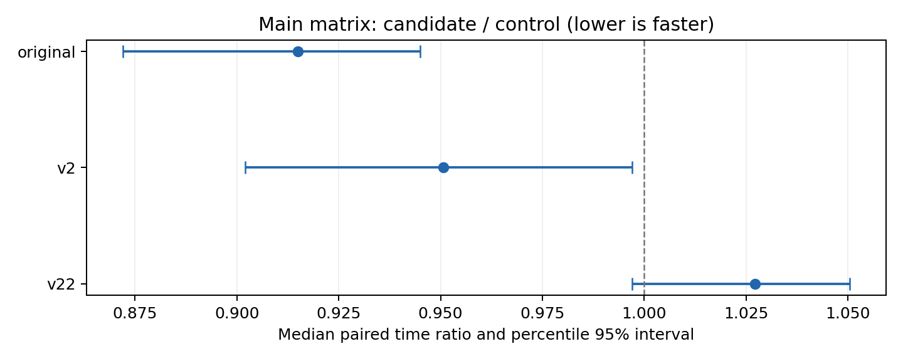
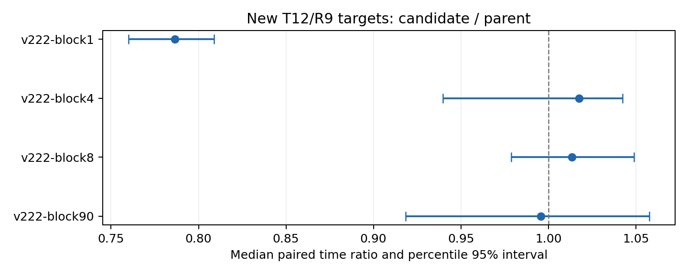

# v2.2.2四版本实验结果

设计77bbb9c2先推送，代码92f45f7随后推送；实现直接基于父版10f6b89。固定提交、输入和统计脚本后完成3952个正式进程、972组相邻进程对，另有24个同二进制诊断进程。正式成绩后没有改生产代码、默认、阈值、R或样本数。

**共同门槛未通过；最终工作分支为optimization/v2。研究分支及全部结果保留。**

| 预先冻结门槛 | 判断 |
| --- | --- |
| 正确性与安全 | 通过 |
| 主条件对最佳已测原始收益 | 通过 |
| 主条件相对v2不退化 | 通过 |
| 主条件相对父版不退化 | 未通过/证据不足 |
| 父版7个关键输入收益保留 | 未通过/证据不足 |
| 新目标覆盖且至少两份改善 | 未通过/证据不足 |
| 旧/新集退化计数不增加 | 未通过/证据不足 |
| A/A达到5%判断精度 | 未通过/证据不足 |

## 主大矩阵：对应配对样本

候选/控制时间比小于1表示本版更快。每个控制只使用自己的20对；不同对照的候选中位数不混用。分项中位数相加不必等于总时间中位数。

| 控制 | 配对数 | 控制总计/ms | 本版总计/ms | 配对时间比中位数 | 95%区间 | 本版P/ms | 本版E/ms |
| --- | --- | --- | --- | --- | --- | --- | --- |
| original | 20 | 708.866 | 646.544 | 0.9149 | [0.8721, 0.9450] | 11.496 | 635.286 |
| v2 | 20 | 640.361 | 608.787 | 0.9506 | [0.9021, 0.9970] | 11.314 | 597.454 |
| v22 | 20 | 609.184 | 620.316 | 1.0272 | [0.9971, 1.0504] | 11.528 | 609.102 |

原始R9最佳已测线程为24。主条件依旧委托旧v2数值路径，观察差异不能直接称新算术内核的收益。wall包含MTX读取与CSR转换，见summary.csv；SpMV阶段收益不能直接当作全程序收益。

## A/A测量分辨率

同一v2程序、相同参数及环境的12对A/A，时间比中位数0.9398，95%区间[0.8625, 1.0400]。AB/BA各6对。预设精度区间为[1/1.05,1.05]，判断为证据不足。A/A只诊断本批测量，不证明任何不同实现等效，也不覆盖跨机器变化。

主条件对v2的配对点估计有表观收益，但uniform输入仍使用原v2数值路径；A/A点估计同样明显偏离1且精度门槛未过。因此不能将主条件差值归因于新区间算法，也不能以该亮点覆盖其他失败门槛。

## 新目标与路径覆盖

| 输入T12/R9 | 本版/父版配对中位时间比 | 时间变化 | 95%区间 | 本版P/ms | 父版P/ms | 本版E/ms | 父版E/ms |
| --- | --- | --- | --- | --- | --- | --- | --- |
| v222-block1 | 0.7865 | -21.35% | [0.7600, 0.8090] | 0.394 | 0.332 | 1.948 | 2.651 |
| v222-block4 | 1.0176 | +1.76% | [0.9396, 1.0423] | 0.409 | 0.341 | 1.940 | 1.958 |
| v222-block8 | 1.0136 | +1.36% | [0.9787, 1.0490] | 0.439 | 0.359 | 1.911 | 1.935 |
| v222-block90 | 0.9958 | -0.42% | [0.9183, 1.0576] | 0.543 | 0.434 | 2.752 | 2.683 |

实际启用新路径的适格新输入记录：{"v222-block1": ["1"], "v222-block4": ["1"], "v222-block8": ["1"], "v222-block90": ["1"], "v222-block64": ["1"]}。超过8个空区间、最长行65及比例/驻留不匹配的输入继续旧路径，详见原始route日志。

新路径保留固定区间payload，不保留动态行号表；准备时父版可能已申请/填表再释放，成本仍计入P。retained_run_bytes只含有效区间payload，不代表整个plan或准备峰值。

单空区间block1在本轮获得配对总成本收益证据；block4/8的准备中位数分别从约0.341/0.359ms增至0.409/0.439ms，而执行中位数仅从约1.958/1.935ms降至1.941/1.912ms，未证明总收益。固定容量和长空区间资格不能替代回本条件。分项中位数仅用于定位阶段，不按直接相加重算总成本。

## 父版关键条件及全部负结果

| 输入 | T | 配对本版/父版 | 时间变化 | 95%区间 |
| --- | --- | --- | --- | --- |
| bcsstk18 | 12 | 1.0075 | +0.75% | [0.9055, 1.0832] |
| bcsstk18 | 24 | 1.0073 | +0.73% | [0.8959, 1.1012] |
| empty99 | 12 | 1.1122 | +11.22% | [1.0848, 1.1682] |
| empty99 | 24 | 1.0660 | +6.60% | [0.9934, 1.1067] |
| giant-row | 12 | 1.0169 | +1.69% | [0.9586, 1.0842] |
| giant-row | 24 | 0.9857 | -1.43% | [0.9504, 1.0247] |
| heavy-clustered | 12 | 0.9621 | -3.79% | [0.8354, 1.0293] |
| heavy-clustered | 24 | 1.0084 | +0.84% | [0.9685, 1.0338] |
| heldout-empty-cluster | 12 | 0.9374 | -6.26% | [0.8939, 0.9858] |
| heldout-empty-cluster | 24 | 0.9435 | -5.65% | [0.9315, 0.9514] |
| heldout-two-giants | 12 | 1.0203 | +2.03% | [0.9229, 1.0313] |
| heldout-two-giants | 24 | 0.9497 | -5.03% | [0.9068, 1.0301] |
| wide | 12 | 1.0156 | +1.56% | [0.9686, 1.0470] |
| wide | 24 | 0.9756 | -2.44% | [0.9497, 1.0025] |

| 组 | 输入数 | 父版相对原始慢>5% | 本版相对原始慢>5% |
| --- | --- | --- | --- |
| old | 80 | 13 | 17 |
| new | 12 | 2 | 0 |

上述计数为描述性统计，没有实际工作负载权重；相对原始的父版和本版样本组不同时，不能用计数代替配对效应或显著性。以下保留全部T12负例（相对原始或父版任一慢>5%），此表使用各组中位数仅供筛查，关键条件正式结论以配对表为准。

| 输入 | 原始/ms | v2/ms | 父版/ms | 本版/ms | 对原始 | 对父版 | 本版P/ms | 本版E/ms | 实际T |
| --- | --- | --- | --- | --- | --- | --- | --- | --- | --- |
| empty99 | 3.393 | 4.527 | 3.446 | 3.825 | +12.73% | +11.01% | 1.306 | 2.487 | 12 |
| random1 | 15.554 | 15.366 | 13.951 | 14.907 | -4.16% | +6.85% | 1.686 | 13.297 | 12 |
| v22-empty90 | 3.523 | 2.748 | 2.235 | 2.360 | -33.02% | +5.57% | 0.333 | 2.033 | 12 |
| v22-empty99 | 2.451 | 2.983 | 2.954 | 3.170 | +29.33% | +7.33% | 0.843 | 2.330 | 12 |
| v222-block88 | 5.853 | 3.758 | 3.314 | 3.506 | -40.10% | +5.80% | 0.595 | 2.911 | 12 |
| v222-period101 | 2.218 | 2.869 | 1.941 | 2.095 | -5.54% | +7.96% | 0.463 | 1.645 | 12 |
| v222-zero | 18.979 | 22.868 | 16.457 | 17.709 | -6.69% | +7.61% | 0.647 | 17.062 | 12 |
| large | 955.333 | 751.677 | 738.545 | 808.101 | -15.41% | +9.42% | 11.256 | 796.845 | 12 |
| banded8 | 3.273 | 3.441 | 3.761 | 3.465 | +5.88% | -7.87% | 0.937 | 2.549 | 12 |
| cache-small | 15.236 | 0.055 | 0.052 | 0.056 | -99.63% | +8.28% | 0.002 | 0.054 | 1 |
| hot8 | 3.365 | 3.508 | 3.499 | 3.731 | +10.89% | +6.63% | 0.920 | 2.732 | 12 |
| new-banded | 2.637 | 2.821 | 2.669 | 2.843 | +7.82% | +6.52% | 0.625 | 2.229 | 12 |
| new-empty-cluster | 2.405 | 2.644 | 2.066 | 2.193 | -8.83% | +6.15% | 0.271 | 1.915 | 12 |
| new-empty-periodic | 2.196 | 2.925 | 2.097 | 2.308 | +5.11% | +10.08% | 0.679 | 1.672 | 12 |
| new-empty-random | 2.195 | 3.152 | 2.966 | 3.455 | +57.41% | +16.47% | 0.673 | 2.807 | 12 |
| new-hot4 | 2.152 | 2.755 | 2.502 | 2.564 | +19.13% | +2.46% | 0.494 | 2.070 | 12 |
| new-iid7 | 2.479 | 3.333 | 2.903 | 2.643 | +6.62% | -8.94% | 0.314 | 2.347 | 12 |
| new-near-serial | 1.835 | 1.585 | 0.104 | 0.116 | -93.70% | +11.27% | 0.017 | 0.099 | 1 |
| new-one-mid | 3.946 | 3.880 | 2.127 | 2.447 | -37.99% | +15.07% | 0.152 | 2.295 | 2 |
| new-zero | 1.890 | 2.253 | 0.191 | 0.284 | -84.96% | +48.51% | 0.161 | 0.114 | 1 |
| random15 | 15.486 | 20.843 | 20.140 | 16.306 | +5.29% | -19.04% | 0.767 | 15.538 | 12 |
| random4 | 17.585 | 19.466 | 18.979 | 18.759 | +6.68% | -1.16% | 1.339 | 17.450 | 12 |
| saylr4 | 1.568 | 0.120 | 0.118 | 0.128 | -91.84% | +8.71% | 0.013 | 0.110 | 1 |
| sherman3 | 1.561 | 0.113 | 0.110 | 0.147 | -90.57% | +33.59% | 0.017 | 0.130 | 1 |
| v22-banded | 3.073 | 3.177 | 3.153 | 3.624 | +17.92% | +14.92% | 0.848 | 2.773 | 12 |
| v22-empty50 | 2.082 | 3.096 | 2.409 | 2.533 | +21.65% | +5.15% | 0.483 | 2.050 | 12 |
| v22-two-giants | 2.712 | 3.745 | 1.970 | 2.075 | -23.50% | +5.31% | 0.115 | 1.965 | 2 |
| v22-zero | 1.740 | 2.296 | 0.324 | 0.420 | -75.89% | +29.45% | 0.276 | 0.142 | 1 |
| v221-column-low | 4.695 | 5.217 | 4.369 | 6.537 | +39.23% | +49.61% | 0.492 | 6.050 | 12 |
| v221-max64 | 2.039 | 2.441 | 1.849 | 2.025 | -0.69% | +9.54% | 0.292 | 1.727 | 12 |
| v221-max65 | 2.035 | 2.638 | 2.030 | 2.410 | +18.44% | +18.74% | 0.326 | 2.084 | 12 |
| v221-random91 | 2.598 | 3.064 | 3.044 | 3.276 | +26.10% | +7.61% | 0.840 | 2.508 | 12 |
| v221-resident-low | 1.850 | 2.150 | 0.638 | 0.806 | -56.43% | +26.28% | 0.088 | 0.718 | 1 |
| v221-zero-high | 1.873 | 2.809 | 2.061 | 2.219 | +18.48% | +7.68% | 0.575 | 1.645 | 12 |
| west0655 | 1.598 | 0.017 | 0.015 | 0.017 | -98.96% | +9.24% | 0.003 | 0.014 | 1 |
| zero | 15.775 | 16.227 | 0.514 | 0.581 | -96.32% | +13.01% | 0.112 | 0.436 | 1 |
| v222-block4 | 2.643 | 3.211 | 2.299 | 2.485 | -5.98% | +8.09% | 0.424 | 2.044 | 12 |
| v222-block8 | 2.405 | 2.813 | 2.295 | 2.466 | +2.55% | +7.43% | 0.451 | 2.010 | 12 |

empty99/T12仍走父版索引执行，P中位数却从0.939增至1.298ms，E从2.480增至2.582ms；可观察增量主要落在准备阶段。本版给非目标输入增加了区间跟踪工作，具体编译组织和系统因素未被单独分离，不能把全部增量直接称为某条指令的成本。未来可检验超过容量后停止额外跟踪等收敛假设，本轮不据此修改实现或重跑成绩。

## 消融、线程和等待策略

| 输入 | 变体 | P/ms | E/ms | 总计/ms | 实际T |
| --- | --- | --- | --- | --- | --- |
| bcsstk18 | v222-parent | 0.055 | 0.610 | 0.666 | 1 |
| bcsstk18 | v222-runs-off | 0.061 | 0.734 | 0.795 | 1 |
| bcsstk18 | v222-runs-on | 0.059 | 0.714 | 0.774 | 1 |
| bcsstk18 | v222-v2 | 0.539 | 1.654 | 2.189 | 12 |
| empty99 | v222-parent | 0.950 | 2.555 | 3.505 | 12 |
| empty99 | v222-runs-off | 1.255 | 2.140 | 3.411 | 12 |
| empty99 | v222-runs-on | 1.398 | 2.546 | 3.948 | 12 |
| empty99 | v222-v2 | 0.688 | 3.086 | 3.730 | 12 |
| heldout-empty-cluster | v222-parent | 0.129 | 1.940 | 2.067 | 12 |
| heldout-empty-cluster | v222-runs-off | 0.154 | 1.766 | 1.922 | 12 |
| heldout-empty-cluster | v222-runs-on | 0.167 | 1.558 | 1.726 | 12 |
| heldout-empty-cluster | v222-v2 | 0.626 | 1.777 | 2.394 | 12 |
| heldout-two-giants | v222-parent | 0.100 | 1.609 | 1.708 | 2 |
| heldout-two-giants | v222-runs-off | 0.103 | 1.563 | 1.665 | 2 |
| heldout-two-giants | v222-runs-on | 0.108 | 1.654 | 1.815 | 2 |
| heldout-two-giants | v222-v2 | 0.573 | 3.222 | 3.795 | 12 |
| random8 | v222-parent | 0.817 | 17.391 | 18.211 | 12 |
| random8 | v222-runs-off | 0.902 | 17.409 | 18.307 | 12 |
| random8 | v222-runs-on | 0.947 | 18.413 | 19.437 | 12 |
| random8 | v222-v2 | 0.886 | 20.801 | 21.672 | 12 |
| v22-empty90 | v222-parent | 0.266 | 2.157 | 2.410 | 12 |
| v22-empty90 | v222-runs-off | 0.326 | 2.101 | 2.426 | 12 |
| v22-empty90 | v222-runs-on | 0.329 | 1.938 | 2.253 | 12 |
| v22-empty90 | v222-v2 | 0.575 | 2.047 | 2.642 | 12 |
| v222-block1 | v222-parent | 0.327 | 2.816 | 3.144 | 12 |
| v222-block1 | v222-runs-off | 0.392 | 2.541 | 2.922 | 12 |
| v222-block1 | v222-runs-on | 0.396 | 1.862 | 2.258 | 12 |
| v222-block1 | v222-v2 | 0.683 | 2.571 | 3.254 | 12 |
| v222-block8 | v222-parent | 0.410 | 2.378 | 2.790 | 12 |
| v222-block8 | v222-runs-off | 0.469 | 2.168 | 2.637 | 12 |
| v222-block8 | v222-runs-on | 0.461 | 1.870 | 2.308 | 12 |
| v222-block8 | v222-v2 | 0.591 | 2.188 | 2.786 | 12 |

消融与主组处于不同时间，不能以它们的微小差值直接作因果贡献。policy=v22保留父版完整准备，runs=off只关闭新区间路径，不关闭旧索引/零矩阵。

## 同二进制的独立进程诊断

每个条件3个独立进程，各后端在每进程12轮中取E中位数，下表再列这3个数的中位数和范围。进程内轮转不当作36个独立样本；各计划同时存活，P只作参考，不能代替正式总成本。

| 输入 | 后端 | 独立进程数 | P中位/ms | E中位/ms | 3进程E范围/ms | 实际T |
| --- | --- | --- | --- | --- | --- | --- |
| bcsstk18 | original | 3 | 0.000 | 1.776 | [1.701, 1.836] | 12 |
| bcsstk18 | v2-auto | 3 | 0.586 | 1.790 | [1.638, 1.851] | 12 |
| bcsstk18 | v22-auto | 3 | 0.062 | 0.704 | [0.689, 0.733] | 1 |
| bcsstk18 | v222-auto | 3 | 0.064 | 0.699 | [0.595, 0.734] | 1 |
| bcsstk18 | v222-policy-parent | 3 | 0.058 | 0.685 | [0.534, 0.752] | 1 |
| bcsstk18 | v222-runs-off | 3 | 0.063 | 0.686 | [0.630, 0.754] | 1 |
| empty99 | original | 3 | 0.000 | 3.290 | [3.193, 3.963] | 12 |
| empty99 | v2-auto | 3 | 0.697 | 3.142 | [2.987, 3.594] | 12 |
| empty99 | v22-auto | 3 | 0.982 | 2.239 | [2.062, 2.352] | 12 |
| empty99 | v222-auto | 3 | 1.180 | 2.130 | [2.072, 2.403] | 12 |
| empty99 | v222-policy-parent | 3 | 0.899 | 2.145 | [2.134, 2.352] | 12 |
| empty99 | v222-runs-off | 3 | 1.188 | 2.078 | [2.073, 2.349] | 12 |
| heldout-two-giants | original | 3 | 0.000 | 2.774 | [2.748, 2.834] | 12 |
| heldout-two-giants | v2-auto | 3 | 0.650 | 3.223 | [3.080, 3.414] | 12 |
| heldout-two-giants | v22-auto | 3 | 0.104 | 1.675 | [1.630, 1.680] | 2 |
| heldout-two-giants | v222-auto | 3 | 0.108 | 1.696 | [1.609, 1.812] | 2 |
| heldout-two-giants | v222-policy-parent | 3 | 0.106 | 1.695 | [1.682, 1.704] | 2 |
| heldout-two-giants | v222-runs-off | 3 | 0.109 | 1.713 | [1.676, 1.731] | 2 |
| large | original | 3 | 0.000 | 756.238 | [756.217, 771.949] | 24 |
| large | v2-auto | 3 | 9.715 | 682.945 | [674.511, 699.365] | 24 |
| large | v22-auto | 3 | 9.610 | 691.418 | [683.565, 701.068] | 24 |
| large | v222-auto | 3 | 9.740 | 692.379 | [684.568, 700.688] | 24 |
| large | v222-policy-parent | 3 | 10.057 | 685.373 | [678.696, 698.539] | 24 |
| large | v222-runs-off | 3 | 9.748 | 701.624 | [697.882, 707.268] | 24 |
| random8 | original | 3 | 0.000 | 20.605 | [20.531, 21.299] | 12 |
| random8 | v2-auto | 3 | 0.750 | 16.942 | [16.297, 16.994] | 12 |
| random8 | v22-auto | 3 | 0.854 | 16.491 | [16.314, 16.668] | 12 |
| random8 | v222-auto | 3 | 0.984 | 16.978 | [16.612, 16.996] | 12 |
| random8 | v222-policy-parent | 3 | 0.842 | 17.296 | [17.097, 17.320] | 12 |
| random8 | v222-runs-off | 3 | 0.936 | 16.888 | [16.652, 17.158] | 12 |
| v22-empty90 | original | 3 | 0.000 | 3.157 | [3.111, 3.238] | 12 |
| v22-empty90 | v2-auto | 3 | 0.607 | 2.040 | [1.930, 2.090] | 12 |
| v22-empty90 | v22-auto | 3 | 0.268 | 2.032 | [1.988, 2.074] | 12 |
| v22-empty90 | v222-auto | 3 | 0.324 | 2.006 | [1.925, 2.076] | 12 |
| v22-empty90 | v222-policy-parent | 3 | 0.265 | 2.042 | [1.934, 2.049] | 12 |
| v22-empty90 | v222-runs-off | 3 | 0.334 | 2.029 | [1.937, 2.040] | 12 |
| v222-block1 | original | 3 | 0.000 | 2.864 | [2.783, 2.959] | 12 |
| v222-block1 | v2-auto | 3 | 0.650 | 2.078 | [1.910, 2.136] | 12 |
| v222-block1 | v22-auto | 3 | 0.322 | 2.413 | [2.387, 2.568] | 12 |
| v222-block1 | v222-auto | 3 | 0.391 | 1.919 | [1.894, 2.003] | 12 |
| v222-block1 | v222-policy-parent | 3 | 0.325 | 2.426 | [2.365, 2.454] | 12 |
| v222-block1 | v222-runs-off | 3 | 0.408 | 2.423 | [2.416, 2.435] | 12 |
| v222-block8 | original | 3 | 0.000 | 2.295 | [2.199, 2.309] | 12 |
| v222-block8 | v2-auto | 3 | 0.576 | 2.145 | [2.084, 2.226] | 12 |
| v222-block8 | v22-auto | 3 | 0.351 | 1.985 | [1.862, 2.048] | 12 |
| v222-block8 | v222-auto | 3 | 0.426 | 1.944 | [1.790, 1.979] | 12 |
| v222-block8 | v222-policy-parent | 3 | 0.328 | 1.901 | [1.869, 1.971] | 12 |
| v222-block8 | v222-runs-off | 3 | 0.466 | 1.945 | [1.775, 2.046] | 12 |

| 输入 | 原始T1总计/ms | 原始T12总计/ms | 本版T12上限总计/ms | 本版实际T |
| --- | --- | --- | --- | --- |
| bcsstk18 | 0.771 | 1.690 | 0.781 | 1 |
| empty99 | 17.509 | 3.393 | 3.825 | 12 |
| giant-row | 8.130 | 8.249 | 5.240 | 12 |
| heavy-clustered | 69.893 | 60.536 | 14.346 | 12 |
| heavy-scattered | 74.685 | 12.529 | 12.384 | 12 |
| heldout-empty-cluster | 1.266 | 2.145 | 1.874 | 12 |
| heldout-iid8 | 49.560 | 9.386 | 8.741 | 12 |
| heldout-small | 0.043 | 1.526 | 0.024 | 1 |
| heldout-two-giants | 1.938 | 2.698 | 1.688 | 2 |
| new-iid8 | 35.712 | 7.342 | 6.175 | 12 |
| new-small | 0.146 | 1.599 | 0.071 | 1 |
| random1 | 92.055 | 15.554 | 14.907 | 12 |
| random64 | 113.416 | 18.462 | 18.024 | 12 |
| random8 | 117.951 | 23.586 | 17.156 | 12 |
| v22-empty90 | 3.224 | 3.523 | 2.360 | 12 |
| v22-empty99 | 6.362 | 2.451 | 3.170 | 12 |
| wide | 0.095 | 14.934 | 0.057 | 1 |

原始T1每条件3进程，仅是额外已测配置；不会把候选实际T1对原始T12的收益全部称为新内核加速。

| 输入 | 变体 | ACTIVE总计/ms | 实际T |
| --- | --- | --- | --- |
| bcsstk18 | original | 0.127 | 12 |
| bcsstk18 | v2 | 0.115 | 12 |
| bcsstk18 | v22 | 1.143 | 1 |
| bcsstk18 | v222 | 1.018 | 1 |
| heldout-two-giants | original | 1.694 | 12 |
| heldout-two-giants | v2 | 0.429 | 12 |
| heldout-two-giants | v22 | 1.364 | 2 |
| heldout-two-giants | v222 | 1.236 | 2 |
| v222-block1 | original | 2.343 | 12 |
| v222-block1 | v2 | 0.794 | 12 |
| v222-block1 | v22 | 2.188 | 12 |
| v222-block1 | v222 | 1.429 | 12 |
| v222-block8 | original | 1.247 | 12 |
| v222-block8 | v2 | 1.027 | 12 |
| v222-block8 | v22 | 1.184 | 12 |
| v222-block8 | v222 | 1.487 | 12 |

ACTIVE仅为单独敏感性组，未用于修改默认或替换PASSIVE主测量。novec强对照见summary.csv的controls组；全局禁向量化影响多个翻译单元，不能将全部变化归因于一处循环。

## 正确性、诊断和局限

- 新区间执行同时使用已有rows/work选择，本轮runs消融不能单独分离区间组织与分区边界改变的贡献。新阈值直接按设计固定，未做保留集拟合。
- native T1/12/24、portable T12及ASan+UBSan T1/12/24，三套测试共21配置全部通过；每配置v2/v2.2/v2.2.2各5368/1007/1197项。另有12项提交前CLI检查、402组完整输出/类型兼容核验，覆盖92份正式输入；另有4组original-novec强编译对照完整输出检查。
- 合成二进制分数使用精确参考；10份真实矩阵先转f32再用独立float64参考及逐行误差界，不称全部误差0。非零初始y、逐次x/values变化、特殊浮点、分配失败及团队改变有单元覆盖。
- 同二进制每条件3个独立进程，每进程6个后端各预热一次、12轮轮转；同进程轮转有关联，不计为独立重复。多个计划同时存活，诊断不能替代独立进程总成本。
- 正式最大RSS 1924.50MiB、最大major faults 6。RSS含COO/CSR转换早期峰值，不能替代新增内存测量。
- csr.c、spmv_v2.c、spmv_v22.c及旧测试源码保留。plan增大可能影响准备机器码和布局，相同源码不保证所有对象代码相同。未以差值直接归因于包装、缓存或某条指令。
- 原始自动向量化保留；优化翻译单元沿原FP约束，不启用全局fast-math。原生产E文本精度为1us、资源wall为0.01s，极小输入百分比需结合绝对时间看。
- 未锁宿主机频率/后台负载，未测硬件DRAM/STREAM或缓存失效；结论限本环境。配对区间未做多重比较校正，胜负计数无实际工作负载权重。
- 补充诊断初版遗漏父版选项参数，首个诊断计时前编译失败。原冻结文件和失败日志保留；bench_compare_fixed.c/diagnostic_fixed.py仅修复接口调用，哈希及补丁见diagnostic-correction.json。正式生产源码、执行命令、样本与统计脚本未改。
- 所有正式记录、固定哈希、负例与失败门槛均保留；未挑样本、事后追加到显著、改变验收或改写历史。

[完整CSV](comparisons.csv) · [全部逐次记录](measurements.csv) · [冻结协议](protocol.json) · [审计](audit.json) · [同二进制诊断](diagnostic.json)
