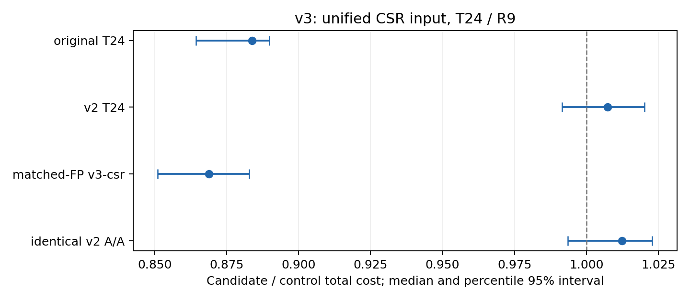

# v3最终优化版本实验结果

设计b67c6374先推送，核心实现e83160bf从原始master 9352c86直接创建并推送，随后固定提交实验；没有继承v1/v2分支历史。v2 9b652e8作为最佳对照。用户指定这是最后一个优化版本。

**共同验收未通过，最终工作分支为optimization/v2；v3分支和全部结果保留。**

| 预设共同门槛 | 判断 |
| --- | --- |
| 正确性/类型/安全 | 通过 |
| 主条件对最佳已测原始至少5%收益 | 通过 |
| 主条件对v2至少5%配对收益 | 未通过/证据不足 |
| 同FP通用CSR对照确认至少5%机制收益 | 通过 |
| 实际转置路径覆盖 | 通过 |
| A/A达到5%精度 | 通过 |
| 生产CLI收益护栏 | 通过 |
| 关键输入退化护栏 | 未通过/证据不足 |
| 旧/新集退化计数不增加 | 通过 |

## 本轮结论与成本解释

主输入为1200万行、9600万非零元，T24/R9。P+E+D总成本中位数：原始709.140ms、v2 615.577ms、v3 623.381ms。配对v3/原始中位数0.8837（下降11.63%）；配对v3/v2为1.0073，95%区间[0.9915, 1.0202]。后者包含1，不能宣称已证明变慢或等效；它没有满足预先要求的至少5%配对改善，因此不替代v2。配对比中位数与两个总时间中位数之比不同，不能互换。

局部转置路线有可测机制收益：相对同FP、相同验证与分区的v3-csr，配对总成本下降13.11%，区间完全低于1；这说明本输入上跨行SIMD优于本版通用后端，却没有证明优于v2的固定8项展开。v2已有固定8项展开；原始对照仍保留原有OpenMP和编译器自动向量化条件。

A/A时间比1.0124，区间[0.9935, 1.0229]，通过5%精度带。本轮没有复现前轮A/A精度不足的问题；v3仍然未通过整体门槛。按用户最后版本约定，恢复并重建v2，结束优化迭代；v3不删除、不合并进master。

## 方法与成本边界

v3在局部8行各8项时按四列一半即时转置寄存器，让每lane保持一个输出行的有序累加。没有整份SELL/其他格式副本、矩阵重排或Ax缓存；每次真实执行y+=Ax，空行实际加零。默认tile8，非适格块和尾部走通用CSR。数据结构验证完整计入P，只有一个大任务检查团队；无动态辅助数组。连续work分区和小任务串行选择不是本版新增贡献。

主对照使用同一个benchmark程序及标准CSR快照加载器，分别链接固定原始CSR、固定v2对象和v3对象。每个进程只执行一个后端；P+R次E+D为总成本，wall另列。夹具由原始MatrixMarket转换器产生，源MTX与夹具双SHA保留。**夹具生成/加载是共同实验基础，不是v3算法收益；其wall不能直接同历史MTX进程混比。** 生产CLI另测，原始CSR/OpenMP/自动向量化均未计作新增贡献。

原始CSR对象被所有后端共享；原始和v2的全局编译设置沿用正式O3/native。v3新单元ffp-contract=off，generic仍允许编译器向量化。v3-csr与默认使用相同FP/验证/分区，是独立机制对照。

## 主标准CSR大矩阵 T24/R9

三版本20个相邻块，同一块的候选同时对应原始和v2；时间比=本版/控制，低于1更快。单项中位数不直接相加替代逐进程总成本。

| 控制 | 请求T(本版/控制) | 块数 | 控制总计/ms | 本版总计/ms | 配对时间比 | 95%区间 | 本版P/ms | 本版E/ms |
| --- | --- | --- | --- | --- | --- | --- | --- | --- |
| original | 24/24 | 20 | 709.140 | 623.381 | 0.8837 | [0.8643, 0.8897] | 10.996 | 612.233 |
| v2 | 24/24 | 20 | 615.577 | 623.381 | 1.0073 | [0.9915, 1.0202] | 10.996 | 612.233 |

原始最佳已测请求线程为24。其最佳选择来自预先固定的线程组，样本数见summary.json；不是全局最优线程证明。若选中12线程，使用预先冻结cross12对照，不外推T24区间。

## 同FP机制对照与A/A

| 控制 | 请求T(本版/控制) | 块数 | 控制总计/ms | 本版总计/ms | 配对时间比 | 95%区间 | 本版P/ms | 本版E/ms |
| --- | --- | --- | --- | --- | --- | --- | --- | --- |
| v3-csr | 24/24 | 10 | 731.026 | 633.979 | 0.8689 | [0.8511, 0.8828] | 11.597 | 622.817 |
| aa-a | 24/24 | 12 | 619.836 | 631.689 | 1.0124 | [0.9935, 1.0229] | 11.422 | 620.440 |

A/A为同一个v2后端、相同二进制/参数/环境的12对，仅外部记录标签不同。精度带预设为[1/1.05,1.05]。通过只支持本批尺度判断，不证明普遍等效；不通过则按预设判为证据不足，不事后追加到显著。

独立gcov探针使用真实变化x和有序参考核对，tile8实际调用12次；计时程序不加覆盖计数。源码中的本地块判断与正式输出simd/backend字段保留，不能把结构命中本身当作收益。

## 生产CLI T24/R9（不与夹具混合）

| 控制 | 请求T(本版/控制) | 块数 | 控制总计/ms | 本版总计/ms | 配对时间比 | 95%区间 | 本版P/ms | 本版E/ms |
| --- | --- | --- | --- | --- | --- | --- | --- | --- |
| original | 24/24 | 5 | 755.437 | 639.152 | 0.9004 | [0.8239, 0.9756] | 11.504 | 628.277 |
| v2 | 24/24 | 5 | 636.223 | 639.152 | 1.0128 | [0.9447, 1.1210] | 11.504 | 628.277 |

此组5个相邻三版本块，保留各程序已有P/E/D输出精度。wall包含MTX解析、CSR转换和日志；以夹具I/O代替MTX的变化不计为优化。小样本区间仅报告，主要统计证据来自预先指定的共同CSR实验。

## 计算总成本与进程耗时分别报告

| 观测 | 版本 | P/ms | R次E/ms | D/ms | P+E+D/ms | 进程wall/ms |
| --- | --- | --- | --- | --- | --- | --- |
| main | original | 0.000 | 709.140 | 0.000 | 709.140 | 1060.000 |
| main | v2 | 11.312 | 604.152 | 0.000 | 615.577 | 970.000 |
| main | v3 | 10.996 | 612.233 | 0.000 | 623.381 | 970.000 |
| cli | original | 0.000 | 755.437 | 0.000 | 755.437 | 9220.000 |
| cli | v2 | 11.599 | 624.624 | 0.000 | 636.223 | 9540.000 |
| cli | v3 | 11.504 | 628.277 | 0.000 | 639.152 | 9920.000 |

P/E/D及wall各取自己的样本中位数，表中中位数不能直接相加。标准CSR共同加载在P计时前，生产CLI的MTX解析/转换也在各自计算计时前；它们仍包含在进程wall中。生产CLI的wall中位数为原始9.22s、v2 9.54s、v3 9.92s，v3在这组端到端观测中没有呈现收益。只有5组、没有对该wall另设显著性判断，不能将此表述为普遍变慢，但更不能把计算阶段约10%的配对收益写成程序整体约10%的加速。

## 关键输入与全部回退

| 输入 | T | 控制 | 配对本版/控制 | 时间变化 | 95%区间 |
| --- | --- | --- | --- | --- | --- |
| bcsstk18 | 12 | original | 1.0625 | +6.25% | [1.0219, 1.1055] |
| bcsstk18 | 12 | v2 | 0.7939 | -20.61% | [0.7292, 0.8224] |
| bcsstk18 | 24 | original | 1.0440 | +4.40% | [1.0052, 1.0750] |
| bcsstk18 | 24 | v2 | 0.7387 | -26.13% | [0.7316, 0.7512] |
| empty99 | 12 | original | 1.2433 | +24.33% | [1.0706, 1.3471] |
| empty99 | 12 | v2 | 0.9988 | -0.12% | [0.9478, 1.1731] |
| empty99 | 24 | original | 1.2235 | +22.35% | [1.1785, 1.2494] |
| empty99 | 24 | v2 | 0.9939 | -0.61% | [0.9662, 1.0237] |
| giant-row | 12 | original | 1.0072 | +0.72% | [0.9632, 1.0329] |
| giant-row | 12 | v2 | 1.5602 | +56.02% | [1.5096, 1.6792] |
| giant-row | 24 | original | 1.0204 | +2.04% | [1.0049, 1.1382] |
| giant-row | 24 | v2 | 1.2768 | +27.68% | [1.2370, 1.3089] |
| heavy-clustered | 12 | original | 0.2362 | -76.38% | [0.2161, 0.2564] |
| heavy-clustered | 12 | v2 | 0.9669 | -3.31% | [0.8921, 1.0730] |
| heavy-clustered | 24 | original | 0.2384 | -76.16% | [0.2321, 0.2527] |
| heavy-clustered | 24 | v2 | 1.1167 | +11.67% | [1.0744, 1.1543] |
| heldout-empty-cluster | 12 | original | 0.8129 | -18.71% | [0.7458, 0.8544] |
| heldout-empty-cluster | 12 | v2 | 0.7860 | -21.40% | [0.7403, 0.8300] |
| heldout-empty-cluster | 24 | original | 0.8858 | -11.42% | [0.8240, 0.9238] |
| heldout-empty-cluster | 24 | v2 | 0.7246 | -27.54% | [0.6967, 0.8000] |
| heldout-two-giants | 12 | original | 1.0268 | +2.68% | [0.9594, 1.0653] |
| heldout-two-giants | 12 | v2 | 0.7294 | -27.06% | [0.7022, 0.7462] |
| heldout-two-giants | 24 | original | 1.0290 | +2.90% | [0.9342, 1.0440] |
| heldout-two-giants | 24 | v2 | 0.6154 | -38.46% | [0.6024, 0.6306] |
| wide | 12 | original | 0.0041 | -99.59% | [0.0040, 0.0043] |
| wide | 12 | v2 | 1.0015 | +0.15% | [0.8661, 1.0602] |
| wide | 24 | original | 0.0021 | -99.79% | [0.0020, 0.0021] |
| wide | 24 | v2 | 1.0074 | +0.74% | [0.9378, 1.0196] |

| 组 | 输入数 | v2对原始慢>10% | v3对原始慢>10% |
| --- | --- | --- | --- |
| old | 92 | 37 | 13 |
| new | 12 | 5 | 5 |

计数是描述统计，无工作负载权重，也不表示逐例显著性。以下列出T12相对原始或v2变慢的全部输入，按各组中位数筛查；关键条件正式判断以配对数据为准。

| 输入 | 原始/ms | v2/ms | v3/ms | 对原始 | 对v2 | P/ms | E/ms | 实际T |
| --- | --- | --- | --- | --- | --- | --- | --- | --- |
| bcsstk18 | 1.741 | 2.413 | 1.837 | +5.51% | -23.87% | 0.046 | 1.765 | 12 |
| empty99 | 4.047 | 4.767 | 4.866 | +20.22% | +2.07% | 0.616 | 4.241 | 12 |
| giant-row | 8.989 | 5.663 | 8.905 | -0.93% | +57.26% | 0.498 | 8.419 | 12 |
| heldout-two-giants | 2.933 | 4.033 | 2.994 | +2.08% | -25.76% | 0.097 | 2.899 | 12 |
| wide | 15.850 | 0.066 | 0.066 | -99.58% | +0.16% | 0.001 | 0.065 | 1 |
| v3-empty99 | 18.985 | 18.718 | 19.463 | +2.52% | +3.98% | 0.055 | 19.407 | 12 |
| v3-ragged78 | 3.428 | 3.866 | 3.943 | +15.03% | +1.98% | 0.514 | 3.429 | 12 |
| v3-ragged89 | 3.816 | 4.101 | 4.645 | +21.72% | +13.27% | 0.546 | 4.098 | 12 |
| v3-rectangle | 3.173 | 4.499 | 3.339 | +5.22% | -25.78% | 0.173 | 3.166 | 12 |
| v3-short16 | 4.715 | 4.797 | 5.493 | +16.50% | +14.50% | 0.673 | 4.820 | 12 |
| v3-short2 | 3.109 | 3.598 | 4.703 | +51.26% | +30.71% | 0.489 | 4.214 | 12 |
| v3-short4 | 3.317 | 4.452 | 4.055 | +22.23% | -8.93% | 0.541 | 3.499 | 12 |
| v3-zero | 21.054 | 22.163 | 22.843 | +8.49% | +3.07% | 0.155 | 22.688 | 12 |
| banded8 | 3.712 | 3.753 | 3.945 | +6.29% | +5.13% | 0.759 | 3.187 | 12 |
| bcsstk14 | 1.593 | 1.880 | 1.766 | +10.87% | -6.04% | 0.021 | 1.746 | 12 |
| bcsstk15 | 1.607 | 2.363 | 1.864 | +16.01% | -21.09% | 0.038 | 1.826 | 12 |
| bcsstk17 | 2.074 | 2.566 | 2.133 | +2.82% | -16.89% | 0.134 | 1.993 | 12 |
| cache-small | 15.762 | 0.064 | 0.081 | -99.48% | +27.63% | 0.001 | 0.080 | 1 |
| heldout-iid9 | 1.761 | 1.817 | 1.856 | +5.38% | +2.16% | 0.025 | 1.825 | 12 |
| heldout-longtail | 8.175 | 3.240 | 3.270 | -60.00% | +0.94% | 0.212 | 3.059 | 12 |
| heldout-medium | 1.672 | 1.744 | 1.789 | +6.99% | +2.59% | 0.023 | 1.765 | 12 |
| heldout-small | 1.693 | 0.031 | 0.034 | -97.99% | +10.10% | 0.004 | 0.030 | 1 |
| hot8 | 3.445 | 3.773 | 4.032 | +17.03% | +6.87% | 0.790 | 3.276 | 12 |
| new-banded | 3.346 | 2.966 | 3.330 | -0.47% | +12.26% | 0.712 | 2.619 | 12 |
| new-eight-giants | 2.265 | 2.870 | 2.485 | +9.71% | -13.40% | 0.110 | 2.375 | 12 |
| new-empty-periodic | 2.487 | 2.963 | 2.751 | +10.59% | -7.16% | 0.118 | 2.632 | 12 |
| new-empty-random | 2.618 | 3.188 | 2.692 | +2.83% | -15.56% | 0.126 | 2.573 | 12 |
| new-hot4 | 2.302 | 2.980 | 2.829 | +22.90% | -5.06% | 0.324 | 2.446 | 12 |
| new-iid7 | 2.702 | 3.319 | 3.268 | +20.94% | -1.55% | 0.256 | 3.003 | 12 |
| new-longtail | 12.284 | 3.862 | 3.962 | -67.74% | +2.60% | 0.310 | 3.639 | 12 |
| new-medium | 1.672 | 2.654 | 1.684 | +0.72% | -36.52% | 0.034 | 1.650 | 12 |
| new-near-serial | 1.687 | 1.790 | 1.714 | +1.56% | -4.24% | 0.011 | 1.703 | 12 |
| new-one-mid | 4.693 | 4.213 | 4.841 | +3.15% | +14.91% | 0.130 | 4.711 | 12 |
| new-small | 1.858 | 0.077 | 0.101 | -94.57% | +31.82% | 0.009 | 0.092 | 1 |
| new-zero | 1.888 | 2.416 | 1.904 | +0.88% | -21.19% | 0.037 | 1.874 | 12 |
| random1 | 19.974 | 14.551 | 17.125 | -14.26% | +17.69% | 0.692 | 16.433 | 12 |
| random15 | 19.377 | 16.174 | 17.104 | -11.73% | +5.75% | 0.711 | 16.419 | 12 |
| random16 | 24.797 | 17.247 | 22.072 | -10.99% | +27.97% | 0.760 | 21.318 | 12 |
| random17 | 18.662 | 18.255 | 18.862 | +1.07% | +3.32% | 0.666 | 18.164 | 12 |
| random2 | 22.132 | 22.068 | 24.445 | +10.45% | +10.77% | 1.004 | 23.441 | 12 |
| random256 | 20.480 | 18.757 | 21.882 | +6.84% | +16.66% | 0.718 | 21.164 | 12 |
| random32 | 18.169 | 18.433 | 19.366 | +6.59% | +5.06% | 0.779 | 18.747 | 12 |
| random4 | 18.780 | 19.385 | 20.764 | +10.56% | +7.11% | 0.794 | 19.975 | 12 |
| random64 | 19.386 | 17.199 | 20.279 | +4.61% | +17.91% | 0.766 | 19.476 | 12 |
| random7 | 19.246 | 16.247 | 21.059 | +9.42% | +29.62% | 0.789 | 20.310 | 12 |
| random8 | 22.035 | 16.863 | 17.906 | -18.74% | +6.18% | 0.664 | 17.274 | 12 |
| random9 | 22.427 | 18.604 | 20.330 | -9.35% | +9.28% | 0.779 | 19.625 | 12 |
| saylr4 | 2.009 | 0.125 | 0.129 | -93.59% | +3.25% | 0.008 | 0.120 | 1 |
| sherman1 | 1.723 | 0.031 | 0.032 | -98.15% | +1.63% | 0.002 | 0.030 | 1 |
| sherman3 | 1.670 | 0.127 | 0.154 | -90.76% | +21.82% | 0.008 | 0.147 | 1 |
| sherman5 | 1.629 | 0.117 | 0.136 | -91.66% | +16.42% | 0.008 | 0.127 | 1 |
| tall | 12.528 | 11.703 | 13.795 | +10.11% | +17.88% | 1.435 | 12.360 | 12 |
| v22-banded | 3.522 | 3.534 | 3.823 | +8.54% | +8.18% | 0.630 | 3.138 | 12 |
| v22-empty50 | 2.267 | 2.692 | 2.312 | +1.96% | -14.13% | 0.110 | 2.202 | 12 |
| v22-empty99 | 2.590 | 3.143 | 3.381 | +30.58% | +7.60% | 0.225 | 2.999 | 12 |
| v22-iid5 | 2.453 | 3.190 | 2.683 | +9.36% | -15.90% | 0.135 | 2.549 | 12 |
| v22-longtail | 15.417 | 4.193 | 4.246 | -72.46% | +1.28% | 0.503 | 3.729 | 12 |
| v22-resident-high | 1.874 | 2.528 | 1.896 | +1.16% | -25.00% | 0.072 | 1.823 | 12 |
| v22-resident-low | 1.886 | 2.333 | 1.918 | +1.68% | -17.80% | 0.056 | 1.862 | 12 |
| v22-six-giants | 2.212 | 2.758 | 2.222 | +0.45% | -19.43% | 0.070 | 2.152 | 12 |
| v22-zero | 1.815 | 2.467 | 1.866 | +2.82% | -24.37% | 0.061 | 1.814 | 12 |
| v221-column-low | 4.085 | 5.089 | 4.435 | +8.57% | -12.84% | 0.486 | 3.950 | 12 |
| v221-max64 | 2.251 | 2.794 | 2.318 | +2.96% | -17.06% | 0.088 | 2.230 | 12 |
| v221-period101 | 2.957 | 3.182 | 3.082 | +4.22% | -3.12% | 0.190 | 2.913 | 12 |
| v221-random91 | 2.641 | 3.222 | 3.154 | +19.45% | -2.10% | 0.184 | 2.970 | 12 |
| v221-zero-high | 2.259 | 2.900 | 2.336 | +3.41% | -19.45% | 0.113 | 2.230 | 12 |
| v221-zero-low | 2.117 | 2.503 | 2.161 | +2.09% | -13.65% | 0.115 | 2.046 | 12 |
| v222-block64 | 4.709 | 3.270 | 3.442 | -26.90% | +5.26% | 0.310 | 3.107 | 12 |
| v222-block9 | 2.840 | 2.990 | 2.947 | +3.78% | -1.44% | 0.134 | 2.788 | 12 |
| v222-iid | 3.257 | 3.377 | 3.342 | +2.61% | -1.03% | 0.283 | 3.059 | 12 |
| v222-period101 | 2.304 | 2.811 | 2.434 | +5.68% | -13.41% | 0.093 | 2.356 | 12 |
| v222-small | 1.700 | 2.342 | 1.926 | +13.31% | -17.76% | 0.055 | 1.840 | 12 |
| v222-zero | 2.318 | 2.666 | 2.449 | +5.67% | -8.13% | 0.119 | 2.330 | 12 |
| west0479 | 1.660 | 0.015 | 0.017 | -98.99% | +12.27% | 0.001 | 0.016 | 1 |
| west0655 | 1.583 | 0.021 | 0.030 | -98.09% | +42.11% | 0.003 | 0.023 | 1 |
| zero | 17.322 | 16.850 | 17.545 | +1.29% | +4.13% | 0.023 | 17.522 | 12 |
| large | 847.635 | 700.963 | 723.593 | -14.63% | +3.23% | 10.936 | 712.657 | 12 |

## 退化来源能解释到哪一步

| 失败护栏 | T | 控制 | 配对变化 | P:控制→本版/ms | E:控制→本版/ms |
| --- | --- | --- | --- | --- | --- |
| empty99 | 12 | original | +24.33% | 0.000→0.616 | 4.047→4.241 |
| empty99 | 24 | original | +22.35% | 0.000→1.000 | 5.006→5.061 |
| heavy-clustered | 24 | v2 | +11.67% | 1.327→0.960 | 12.213→14.151 |

empty99的8行均长8资格不成立，转置不能帮助该形状。与原始相比，本版完整验证带来可见P；执行阶段也没有足够下降将其抵消。T12/T24配对总成本分别增加24.33%/22.35%，均超过10%护栏。这是以总成本检验优化的必要性，不能只引用E或“不申请动态数组”来忽略准备工作。

heavy-clustered/T24对v2配对增加11.67%，本版P反而更低，退化主要出现在本批E观测。v3的通用后端、局部块检查、FP设置与v2的策略/代码生成存在多项差异；没有硬件计数或逐因素配对证据，不能锁定为gather、缓存、FMA或某一条指令造成。T12的配对点值则下降3.31%且区间跨1，表明线程条件影响结论，不能用一个T代表全部。

巨行没有拆分是本路线的明确边界。giant-row/T12对原始配对约+0.72%而对v2的合并中位数高约57.26%；v2已有merge拆行机制，v3没有继承。该例虽未触发对原始10%的指定护栏，仍作为负面证据保留。局部tile资格严格要求8行各8项，ragged7/8、长度2/4/7/16等形状不能据全8主输入外推；全部回退表和保留集展示这些限制。

旧92份T12相对原始慢超过10%的计数由v2的37降至v3的13，新12份为5→5，覆盖面有改善，但输入没有实际工作负载权重，不能用胜负计数覆盖主条件与关键护栏的失败。新路线证明了部分结构上的价值，本轮证据支持保留为研究结果，尚不足以替代v2作为最终交付版本。

## 新12份保留集

| 输入 | T | R | 原始/ms | v2/ms | v3/ms | 对v2 |
| --- | --- | --- | --- | --- | --- | --- |
| v3-empty99 | 12 | 100 | 18.985 | 18.718 | 19.463 | +3.98% |
| v3-empty99 | 24 | 100 | 34.247 | 34.947 | 34.699 | -0.71% |
| v3-local-mix | 12 | 9 | 4.307 | 4.838 | 4.281 | -11.52% |
| v3-local-mix | 24 | 9 | 5.007 | 6.177 | 6.151 | -0.42% |
| v3-ragged78 | 12 | 9 | 3.428 | 3.866 | 3.943 | +1.98% |
| v3-ragged78 | 24 | 9 | 5.200 | 5.609 | 5.519 | -1.62% |
| v3-ragged89 | 12 | 9 | 3.816 | 4.101 | 4.645 | +13.27% |
| v3-ragged89 | 24 | 9 | 5.357 | 6.725 | 5.969 | -11.25% |
| v3-rectangle | 12 | 9 | 3.173 | 4.499 | 3.339 | -25.78% |
| v3-rectangle | 24 | 9 | 4.898 | 5.615 | 4.665 | -16.91% |
| v3-short16 | 12 | 9 | 4.715 | 4.797 | 5.493 | +14.50% |
| v3-short16 | 24 | 9 | 6.348 | 6.799 | 6.885 | +1.26% |
| v3-short2 | 12 | 9 | 3.109 | 3.598 | 4.703 | +30.71% |
| v3-short2 | 24 | 9 | 4.524 | 5.467 | 5.604 | +2.51% |
| v3-short4 | 12 | 9 | 3.317 | 4.452 | 4.055 | -8.93% |
| v3-short4 | 24 | 9 | 4.465 | 5.925 | 5.420 | -8.52% |
| v3-tail7 | 12 | 9 | 3.949 | 3.944 | 3.676 | -6.80% |
| v3-tail7 | 24 | 9 | 4.612 | 5.515 | 5.286 | -4.16% |
| v3-u8-small | 12 | 9 | 2.906 | 3.148 | 2.882 | -8.47% |
| v3-u8-small | 24 | 9 | 4.055 | 5.146 | 4.199 | -18.42% |
| v3-u8-wide | 12 | 9 | 27.228 | 23.658 | 23.117 | -2.29% |
| v3-u8-wide | 24 | 9 | 23.425 | 21.840 | 25.531 | +16.90% |
| v3-zero | 12 | 100 | 21.054 | 22.163 | 22.843 | +3.07% |
| v3-zero | 24 | 100 | 34.835 | 34.922 | 34.610 | -0.89% |

## 独立校准、消融及敏感性

8份独立形状、288次提交前校准。非8行组auto/tile8几何均值0.9800，最差组1.2252；未满足预设<=0.97及无组退化>10%，故默认保留tile8。没有用保留集调默认。校准后仅补NO_OPENMP兼容宏；变更及校准源重构见calibration-compatibility.json。

| 输入 | 变体 | T | P/ms | E/ms | 总计/ms | 实际T |
| --- | --- | --- | --- | --- | --- | --- |
| giant-row | v3-csr | 12 | 0.540 | 8.403 | 8.907 | 12 |
| giant-row | v3-pipeline | 12 | 0.552 | 8.685 | 9.237 | 12 |
| giant-row | v3-rows | 12 | 0.521 | 9.416 | 9.919 | 12 |
| giant-row | v3-tile | 12 | 0.485 | 9.013 | 9.490 | 12 |
| heavy-clustered | v3-csr | 12 | 0.653 | 15.561 | 16.115 | 12 |
| heavy-clustered | v3-pipeline | 12 | 0.683 | 11.373 | 12.142 | 12 |
| heavy-clustered | v3-rows | 12 | 0.587 | 61.901 | 62.570 | 12 |
| heavy-clustered | v3-tile | 12 | 0.662 | 14.480 | 15.142 | 12 |
| large | v3-csr | 24 | 10.939 | 688.001 | 698.571 | 24 |
| large | v3-pipeline | 24 | 11.276 | 669.087 | 680.213 | 24 |
| large | v3-rows | 24 | 11.929 | 626.087 | 638.016 | 24 |
| large | v3-tile | 24 | 11.000 | 613.123 | 623.993 | 24 |
| random8 | v3-csr | 12 | 0.675 | 17.696 | 18.496 | 12 |
| random8 | v3-pipeline | 12 | 0.898 | 16.485 | 17.383 | 12 |
| random8 | v3-rows | 12 | 0.731 | 17.620 | 18.325 | 12 |
| random8 | v3-tile | 12 | 0.808 | 17.414 | 18.123 | 12 |
| v3-ragged78 | v3-csr | 12 | 0.555 | 3.360 | 3.916 | 12 |
| v3-ragged78 | v3-pipeline | 12 | 0.497 | 3.433 | 3.996 | 12 |
| v3-ragged78 | v3-rows | 12 | 0.506 | 3.545 | 3.999 | 12 |
| v3-ragged78 | v3-tile | 12 | 0.579 | 3.580 | 4.163 | 12 |
| v3-short4 | v3-csr | 12 | 0.522 | 3.382 | 3.896 | 12 |
| v3-short4 | v3-pipeline | 12 | 0.561 | 3.583 | 4.103 | 12 |
| v3-short4 | v3-rows | 12 | 0.584 | 3.614 | 4.140 | 12 |
| v3-short4 | v3-tile | 12 | 0.577 | 3.707 | 4.284 | 12 |

显式pipeline4在高度不均匀的4行块中可能受最长行拖累；default未将该候选用于非tile块。rows/work消融只改边界，其他准备相同。消融小样本与正式块不同时段，不将微小差值直接归因某一指令。

| 组 | 输入 | 变体 | T | R | P/ms | E/ms | 总计/ms | 实际T |
| --- | --- | --- | --- | --- | --- | --- | --- | --- |
| original-best | bcsstk18 | original | 1 | 9 | 0.000 | 0.751 | 0.751 | 1 |
| original-best | empty99 | original | 1 | 9 | 0.000 | 20.429 | 20.429 | 1 |
| original-best | giant-row | original | 1 | 9 | 0.000 | 10.310 | 10.310 | 1 |
| original-best | heavy-clustered | original | 1 | 9 | 0.000 | 74.743 | 74.743 | 1 |
| original-best | heldout-empty-cluster | original | 1 | 9 | 0.000 | 1.884 | 1.884 | 1 |
| original-best | heldout-two-giants | original | 1 | 9 | 0.000 | 1.946 | 1.946 | 1 |
| original-best | wide | original | 1 | 100 | 0.000 | 0.113 | 0.113 | 1 |
| sensitivity | large | original | 1 | 9 | 0.000 | 5622.245 | 5622.245 | 1 |
| sensitivity | large | original | 12 | 9 | 0.000 | 847.635 | 847.635 | 12 |
| sensitivity | large | original | 2 | 9 | 0.000 | 3001.215 | 3001.215 | 2 |
| sensitivity | large | original | 24 | 1 | 0.000 | 83.735 | 83.735 | 24 |
| sensitivity | large | original | 24 | 100 | 0.000 | 8023.142 | 8023.142 | 24 |
| sensitivity | large | original | 4 | 9 | 0.000 | 1584.972 | 1584.972 | 4 |
| sensitivity | large | original | 8 | 9 | 0.000 | 989.360 | 989.360 | 8 |
| sensitivity | large | v2 | 1 | 9 | 36.833 | 4067.296 | 4104.129 | 1 |
| sensitivity | large | v2 | 12 | 9 | 11.543 | 689.419 | 700.963 | 12 |
| sensitivity | large | v2 | 24 | 1 | 11.453 | 69.664 | 81.118 | 24 |
| sensitivity | large | v2 | 24 | 100 | 11.456 | 6988.059 | 6999.196 | 24 |
| sensitivity | large | v3 | 1 | 9 | 31.761 | 4025.393 | 4057.154 | 1 |
| sensitivity | large | v3 | 12 | 9 | 10.936 | 712.657 | 723.593 | 12 |
| sensitivity | large | v3 | 24 | 1 | 10.922 | 69.843 | 80.765 | 24 |
| sensitivity | large | v3 | 24 | 100 | 11.696 | 7026.248 | 7037.595 | 24 |
| waiting | bcsstk18 | original | 12 | 9 | 0.000 | 0.121 | 0.121 | 12 |
| waiting | bcsstk18 | v2 | 12 | 9 | 0.017 | 0.099 | 0.115 | 12 |
| waiting | bcsstk18 | v3 | 12 | 9 | 0.052 | 0.138 | 0.189 | 12 |
| waiting | random8 | original | 12 | 9 | 0.000 | 22.130 | 22.130 | 12 |
| waiting | random8 | v2 | 12 | 9 | 0.340 | 19.380 | 19.982 | 12 |
| waiting | random8 | v3 | 12 | 9 | 0.344 | 19.850 | 20.350 | 12 |
| waiting | v3-short4 | original | 12 | 9 | 0.000 | 2.431 | 2.431 | 12 |
| waiting | v3-short4 | v2 | 12 | 9 | 0.188 | 2.527 | 2.754 | 12 |
| waiting | v3-short4 | v3 | 12 | 9 | 0.205 | 2.677 | 2.888 | 12 |
| waiting | v3-u8-wide | original | 12 | 9 | 0.000 | 28.940 | 28.940 | 12 |
| waiting | v3-u8-wide | v2 | 12 | 9 | 0.791 | 26.659 | 27.450 | 12 |
| waiting | v3-u8-wide | v3 | 12 | 9 | 0.970 | 29.887 | 30.869 | 12 |

ACTIVE是双方一致的附加敏感性组，没有据此改变PASSIVE主条件。原始T1对小任务的结果用于区分线程选择与同线程内核收益，不把串行选择全部称为新SIMD加速。

## 正确性、审计与局限

- 104输入，464组完整输出检查（含104组生产CLI）、10组类型/对称兼容；8组native/portable/ASan+UBSan/无OpenMP配置，每组4156项。另有15项CLI参数检查、无OpenMP生产构建及独立tile覆盖探针。
- 精确二进制分数输入用精确参考；真实输入先转f32再用独立float64参考及逐行误差界，CLI输出50位避免舍零，不称真实误差均0。源值和x逐次变化、非零y、NaN/Inf/-0、64位偏移、非法CSR及团队变化均覆盖。
- 固定提交归档构建的benchmark .text/.rodata/.data与提交前完整核验构建一致；源文件/输入/夹具/程序和冻结脚本哈希均审计。原始csr.c不改，旧v2对象独立链接，不合入v2提交。
- 正式1645个进程（含15个生产CLI），169个双/三版本块。最大RSS 1924.12MiB、最大major faults 4。全程RSS包含共同输入加载和CLI COO峰值，不代表新内核辅助内存。
- 无动态格式副本；固定计划、寄存器和可能的编译器栈spill均不能等同于零总空间开销。夹具本体与构建不入Git，生成方法和双SHA留档。
- 同可执行文件减少链接布局和计时框架差异，不能消除地址随机化、宿主负载、频率及CPU放置差异。未锁频，未测DRAM控制器/STREAM/缓存硬件事件；不将时间差或逻辑访存量当作已证明的硬件瓶颈。
- 逐条件区间未作多重比较校正；三进程组和胜负计数仅描述。结果限记录环境、矩阵和R，不能宣称任何输入都更快。
- 本版是最后一轮；未通过则保留v3并回到v2，不事后修改门槛、样本数或R。上游PR和课程最终报告另待后续任务。

[完整逐次CSV](measurements.csv) · [全部条件](comparisons.csv) · [配对数据](paired-analysis.json) · [决策](decision.json) · [审计](audit.json)
